<p align="center"></p>

# PlanyTrip

**Plan a group trip where everyone fits the budget and nobody spends 23 hours in transit.**

<p align="center">
  
  
  
  
  
  
  
  <br>
  
  
  
  
  
  
</p>

<p align="center">
  <a href="PlanyTrip-promo.mp4"></a>
  <br>
  <sub>PlanyTrip in 24 seconds. <a href="PlanyTrip-promo.mp4">Watch the video (.mp4)</a></sub>
</p>

PlanyTrip is a local web app that helps a group of friends living in different cities decide **where** to go. You enter each guest (home city, budget, availability, how they travel) and a few candidate destinations. The app looks for real flights, trains, buses, drives and places to stay, works out what the trip costs **each** guest, scores how comfortable each journey is, and says which destination works for everyone. Every number comes with the reasoning behind it.

It runs on your own computer, for personal use. There is no account and no server.

---

## The problem it solves

Martin (Madrid, 800 €, only drives), Chloé (Paris, 1,200 €, flies) and Jessy (Madrid, 400 €, flies) can't decide between **Barcelona**, **La Réunion** and **Le Mont-Saxonnex**. Martin can only stay until 5 September.

PlanyTrip answers:

- **When:** the common window is 26 August → 5 September (10 nights), limited by Martin.
- **Who can get where:** there is no road to La Réunion, so Martin can't drive there. The app suggests another way.
- **What it costs each person:** their own transport, their share of the stay, and what they will spend once there.
- **Is it bearable:** journeys with 3 stops and 23 h of travel, or 13 h alone at the wheel, are flagged and left out by default.
- **The verdict:** no destination works for everyone yet. Barcelona (2,697 € for the group) is the closest, and the app says why: Jessy is 172 € over budget once food and the tourist tax are counted. It also says what to change.

This is the reference scenario. `npm run db:seed` loads it, and the tests check its figures.

---

## Features

- **Setup in steps:** guests → destinations → accepted means of transport, checking live who can get where.
- **Real offers:** flights (Google Flights), trains (timetables of all Europe, with real fares where a source gives them), buses (FlixBus), car routes with tolls and fuel, places to stay (Airbnb and Google Hotels).
- **The budget, guest by guest:** transport + share of the stay + the *Extra*, against each guest's own budget.
- **The Extra:** what is spent once there. Food, the way from the airport, the tourist tax, then what the trip is for: nights out, a spa, visits, or hikes. Each amount shows how it is worked out and where its prices come from.
- **Rated once by the AI:** Claude rates every stay and journey while the trip is set up, and gives advice on fitting the budgets. The dashboard never waits for it. Without the AI, simple rules rate instead, and the app says so.
- **Choosing together:** ❤ an offer and every budget updates at once; ★ votes for a destination.
- **A recommendation that explains itself:** which destination wins, or what blocks each one ("Jessy +172 €").
- **Estimated times while it computes**, learnt from the searches already made on your computer.
- **Validate and export:** freeze the decision with its prices and links, and export it as a PDF.

---

## Getting started (macOS)

You need **Node.js 22.12+** (or 24), npm, **Google Chrome**, and a Claude subscription for the AI (optional).

```bash
git clone <repo-url> trip-manager && cd trip-manager
npm install

npm run airports          # download the list of airports (the tests need it too)
npm run db:migrate        # create data/trip.db
npm run db:seed           # optional: load the Martin / Chloé / Jessy trip
npm run dev               # the app and its worker, on http://localhost:3000
```

For the AI, install Claude Code and sign in once: `npm i -g @anthropic-ai/claude-code && claude`.

If `better-sqlite3` fails to build, run `xcode-select --install` and install again.

The first computation of a trip takes from a few minutes to over half an hour, depending on how many guests and destinations there are: the sites are read one page at a time, with a real Chrome in the background. What was found is kept.

| Command | What it does |
|---|---|
| `npm run dev` | Starts the app and the worker together |
| `npm run worker` | Starts the worker alone |
| `npm test` | Runs the tests (after `npm run airports`) |
| `npm run lint` | Checks the code style |
| `npx next typegen && npx tsc --noEmit` | Checks the types |
| `npm run db:migrate` | Updates the database. Run it after pulling a change |
| `npm run db:studio` | Browses the database |

### Settings

All optional. Put them in a `.env.local` file at the root, which is never committed.

| Variable | What it does |
|---|---|
| `TRIP_CONTACT=you@example.org` | Who is asking: sent to Transitous only, which requires it |
| `TRIP_CLAUDE_MODE=docker` | Runs `claude` in a throwaway container (below) instead of on this computer |
| `TRIP_STAYS_ADAPTER=fixture` | Sample places to stay instead of Airbnb |
| `TRIP_FLIGHTS_ADAPTER=fixture` | Sample flights instead of Google Flights |
| `TRIP_HOTELS_ADAPTER=none` | No hotels |
| `TRIP_GROUND_ADAPTER=none` | No FlixBus buses or trains |
| `TRIP_TRAINS_ADAPTER=none` | No trains from the European timetables, nor RegioJet |
| `SCRAPE_HEADFUL=1` | Shows the Chrome window while it searches |
| `TRIP_DB_PATH=/some/copy.db` | Uses another database file, to try things on a copy |
| `OSRM_URL`, `VALHALLA_URL`, `OVERPASS_URL` | Your own routing or map servers |

### Claude in Docker (optional)

Nothing from your computer is visible to the container, which is thrown away after each call. Docker has to be running (`docker desktop start`).

```bash
claude setup-token                                          # prints a long-lived token
echo 'CLAUDE_CODE_OAUTH_TOKEN=<the token>' >> .env.local    # keep it private: it is your subscription
echo 'TRIP_CLAUDE_MODE=docker' >> .env.local
npm run claude:image
```

Then restart `npm run dev`. Settings → AI says whether it is ready.

### Real train prices (optional)

A train that no source prices is estimated and marked "≈". There are three ways to do better:

- **SNCF Connect:** a switch in Settings reads its trains and prices through the Chrome already open on your computer. It needs Python (`uv` or `python3`). See [tools/sncf-api](./tools/sncf-api/README.md).
- **The prices you see yourself** on SNCF Connect, Eurostar and Iryo: a Chrome extension sends them to the app when you click. See [extension/sncf-import](./extension/sncf-import/README.md).
- **A price model** trained on those prices (`npm run model:train`, needs `uv`), used only once it beats the estimates. See [price-model.md](./price-model.md).

---

## A quick look

Three friends want a weekend away: Mael lives in Toulouse, Benjamin in Nantes and Ethan in Lyon. They hesitate between Prague, Milan, Amsterdam and Reading. Here is what PlanyTrip shows them, page by page.

It starts with a few questions: who is coming, where you could go, and how each guest accepts to travel. The app then searches for the offers, and shows its progress and the time left. After that, everything is on the pages below.

### Home: the trip at a glance

<p align="center">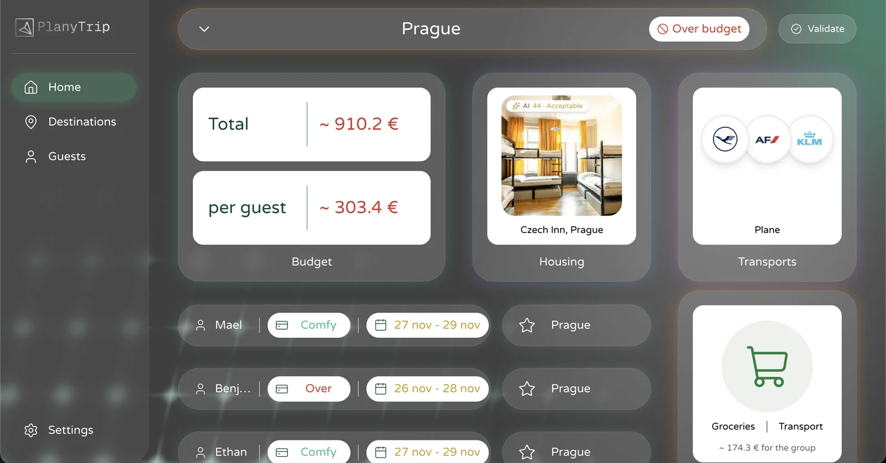</p>

Choose a destination at the top. Four cards sum it up, and each one opens its own page:

- **Budget:** what the trip costs, for the group and for each guest.
- **Housing:** the recommended place to stay, with its photo and its score.
- **Transports:** the companies that take everyone there.
- **Extra:** what is spent once there, such as food and local transport.

Below, each guest has a row: whether the trip fits their budget, when they are free, and a ★ to vote for the destination. Here Prague is *Over budget*, because of Benjamin.

### Guests: who is coming

<p align="center">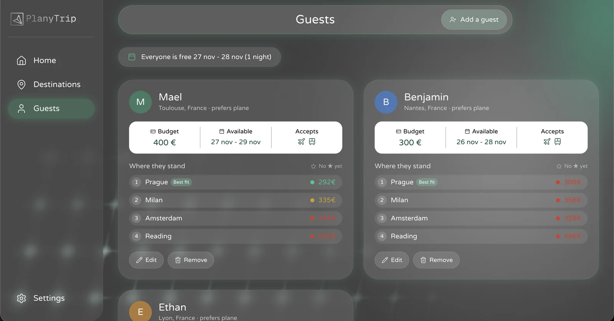</p>

Each guest has their own budget, their own dates and the means of transport they accept. The banner gives the dates when **everyone** is free. *Where they stand* ranks the destinations for that person, and *Best fit* marks the one that suits them most. You can add, edit or remove a guest at any time.

### Destinations: where to go

<p align="center">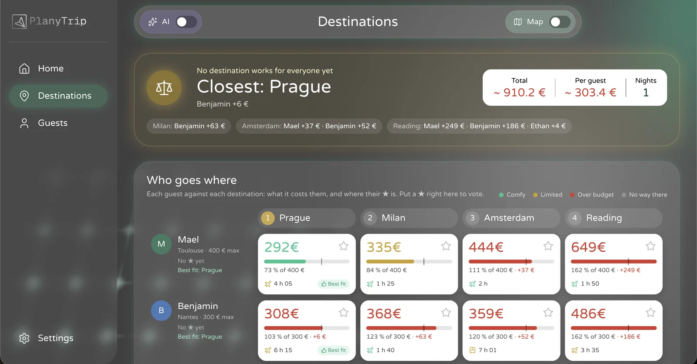</p>

The banner gives the answer. Here no destination works for everyone yet: **Prague is the closest, and only 6 € are missing for Benjamin**. The other destinations say what blocks them too.

Below, *Who goes where* crosses each guest with each destination: the price, its share of their budget, and how long the journey takes.

<p align="center">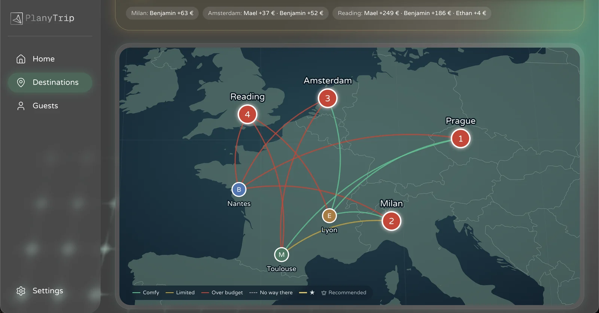</p>

Turn on **Map** to see the journeys, coloured by how well they fit each budget. Turn on **AI** to read what it thinks of the destinations.

<p align="center">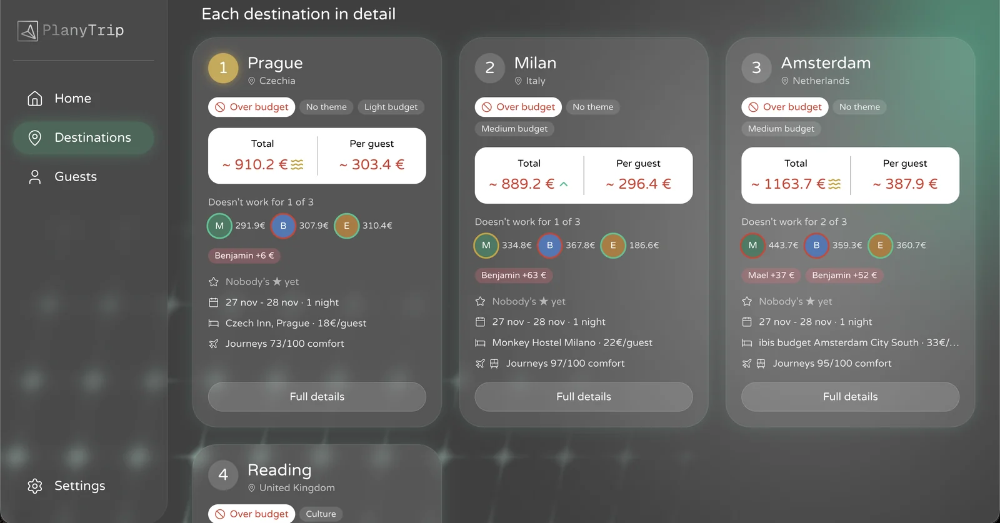</p>

Each destination also has its card: its price, who it works for, who has voted for it, the dates, the place to stay and how comfortable the journeys are. The ring around a guest has the colour of their budget.

### Budget: what it costs

<p align="center">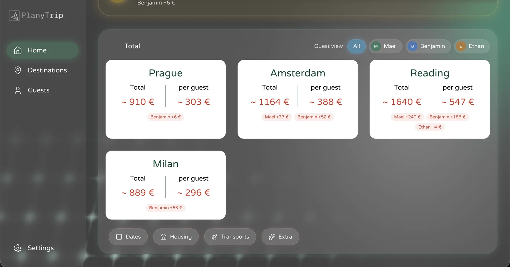</p>

The destinations side by side. *Guest view* shows the price for one person only. The buttons at the bottom add the dates, the housing, the transports or the Extra to each card, to compare one thing at a time.

### Transports: how to get there

<p align="center">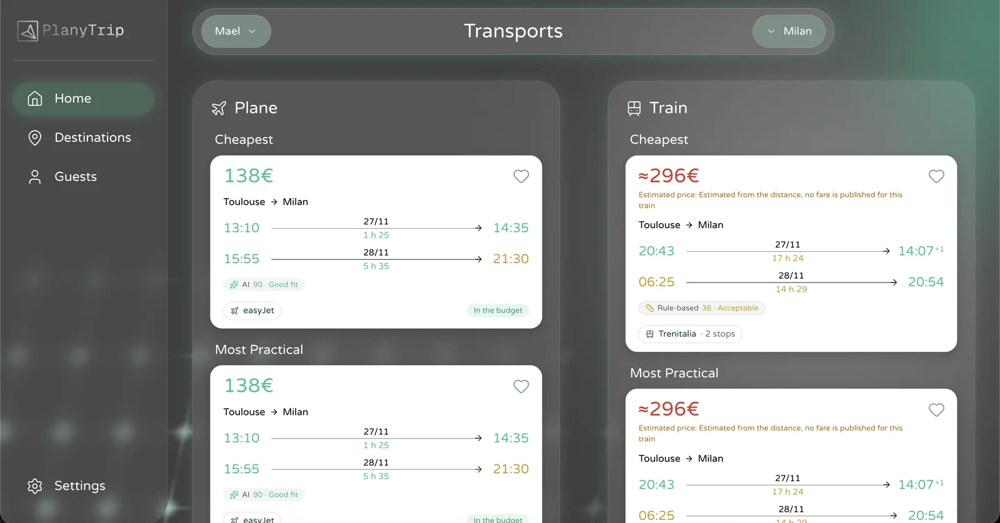</p>

Choose a guest and a destination. Each means of transport has its column, with the **cheapest** journey and the **most practical** one. The colours of the times show how comfortable they are. Put a ❤ on the journey you want, and the budget follows.

### Housing: where to sleep

<p align="center">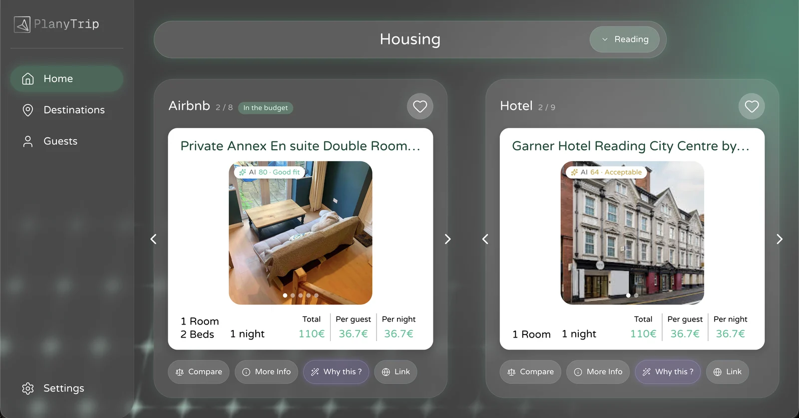</p>

Airbnb on one side, hotels on the other, best first: use the arrows to see the next ones. Each place has its photos, its score and its price, in total, per guest and per night. **Compare** puts two or three of them side by side, **More Info** gives the details, **Link** opens the seller's page, and the ❤ is the group's choice.

Not sure? Press **Why this?**. The AI reads the offer, and explains what is good and less good about it for *your* group:

| While it thinks | Its answer |
|:---:|:---:|
| 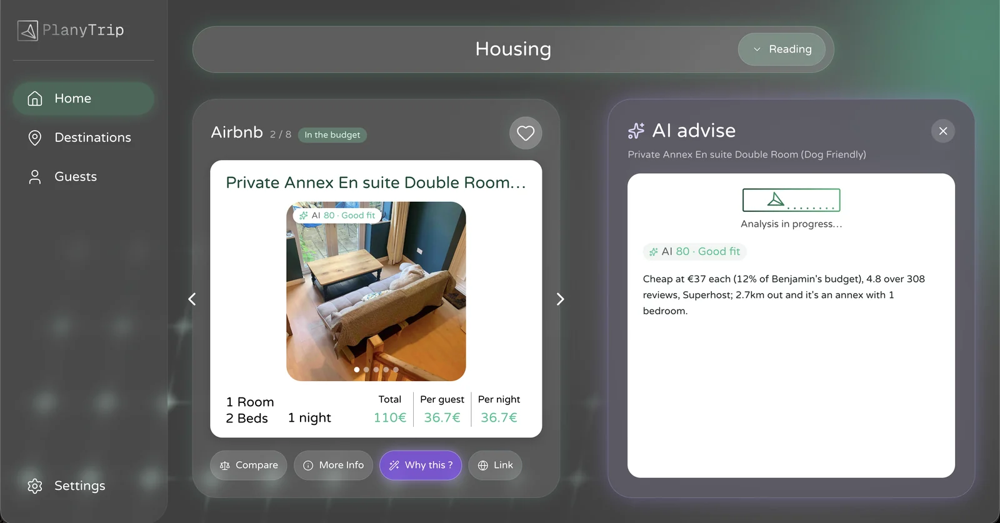 | 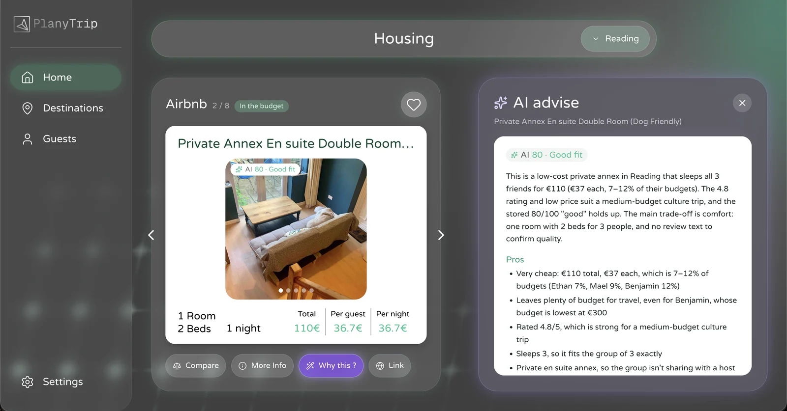 |

### Extra: what you spend once there

<p align="center">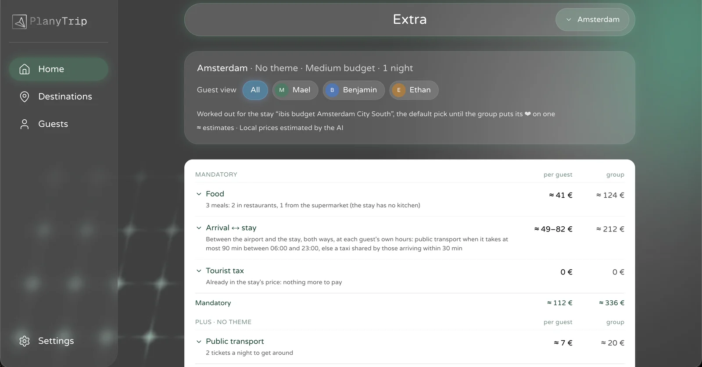</p>

The costs that are often forgotten. **Mandatory** is what cannot be avoided: food, the way between the airport and the stay, the tourist tax. **Plus** depends on what the trip is for. Each line opens to show how it is worked out, and you can look at the whole group or at one guest.

### And to finish

Everyone agrees? Press **Validate**: the decision is kept with its prices and its links, and you can export it as a PDF to send to the group.

### Reading the colours and the signs

| You see | It means |
|---|---|
| 🟢 Green, *Comfy* | All in all, at most 80 % of the guest's budget |
| 🟡 Yellow, *Limited* | It fits, but without much room |
| 🔴 Red, *Over* | What cannot be avoided costs more than their budget: "+6 €" is what is missing |
| ⚪ Grey, *No way there* | They cannot get there with the means of transport they accept |
| ★ | A guest's vote for a destination |
| ❤ | The journey or the place chosen: the budget is worked out with it |
| *In the budget* | The offer the budget is worked out with, whether you chose it or the app did |
| ≈ before a price | An estimate: no seller gave this price |
| ~ before a price | Rounded |
| *AI* 80 · Good fit | A score out of 100, given by the AI |
| *Rule-based* 36 · Acceptable | A score given by simple rules, without the AI |
| ︿ ≋ ﹀ after a total | The lowest of the destinations, in between, the highest |

---

## How it works

```
Browser ──► Next.js (pages + API) ──► SQLite ◄── Worker (Node)
                                                  ├─ searches: flights, trains, buses, drives, stays
                                                  ├─ places, local prices, tourist taxes, fuel
                                                  └─ claude -p: ratings, local prices, advice
```

- Pages and API routes call **services**, which call a pure **core** (dates, comfort, pricing, the Extra, the recommendation). Costs are never stored: they are worked out on every read, so a ❤ shows at once.
- Long work runs as **jobs** in a separate worker, one at a time; the page follows their progress.

**Data:** [OpenStreetMap](https://www.openstreetmap.org/copyright) (Photon, OSRM, Valhalla, Overpass) · [Transitous](https://transitous.org/sources/) · OurAirports · SNCF open data · Eurostar, Iryo and SNCF Connect prices you see yourself · Trenitalia · RegioJet · FlixBus · Google Flights and Hotels · Airbnb · DiscoverCars · Eurostat and the EU Weekly Oil Bulletin (© European Union) · French open data (tourist taxes)

## Documentation

| Document | Content |
|---|---|
| [use-cases.md](./use-cases.md) | The reference scenario, the rules, and the use cases with their acceptance criteria |
| [architecture.md](./architecture.md) | Components, folders, the Claude integration |
| [database.md](./database.md) | The database and its integrity rules |
| [task.md](./task.md) | What was built, step by step, and the API reference |
| [extra.md](./extra.md) | The Extra: what is spent once there |
| [train-sources.md](./train-sources.md), [rental-sources.md](./rental-sources.md) | Where train and rental car prices come from, and what was tried |
| [price-model.md](./price-model.md) | The train-price model |

## Disclaimer

For personal use. Reading third-party travel sites automatically may be against their terms of service: that is your responsibility. Prices are indicative; always check on the seller's site before booking. The names and logos of companies belong to them.
