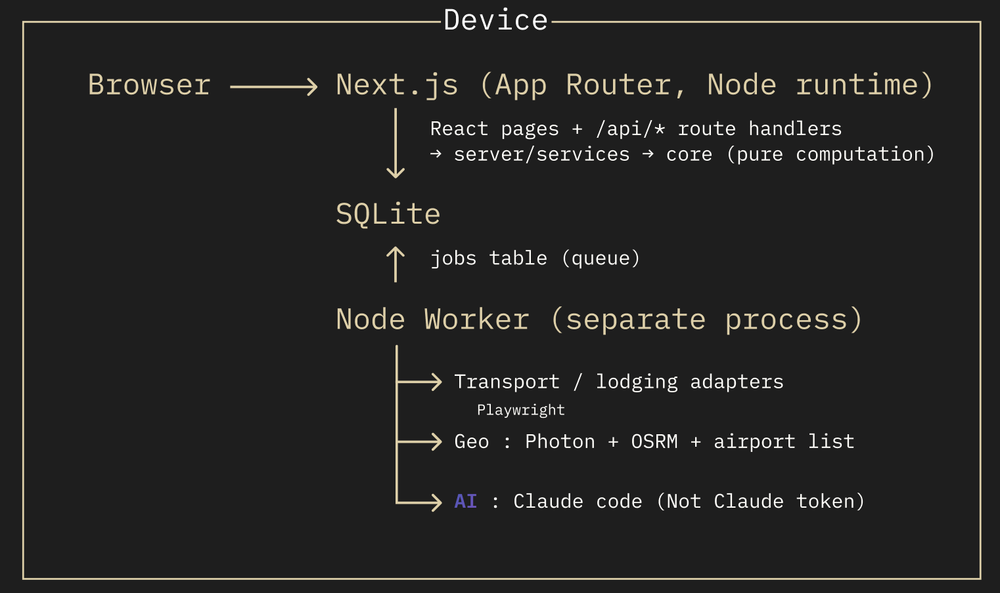

# PlanyTrip — Architecture

> Companions: [use-cases.md](./use-cases.md) · [database.md](./database.md) · [task.md](./task.md)
> A **local** app, for personal use, with zero API spend.

---

## Overview

<p align="center"></p>

**Why a separate worker?** A full computation takes several minutes. A Next.js HTTP request shouldn't stay open that long, and a `next dev` reload shouldn't kill a scrape in progress. The UI creates **jobs** in SQLite, the worker runs them and writes the results, and the UI polls `/api/trips/:id/progress`.

**What is never stored:** scenarios, per-guest costs, colors, trends and the recommendation. They are recomputed by `core/*` on every read, so a heart or a star applies instantly.

One command starts everything: `npm run dev` runs Next.js and the worker together.

---

## Stack

| Layer | Choice | Why |
|---|---|---|
| Framework | **Next.js** + **TypeScript** | UI + API in one project |
| UI | **Tailwind CSS** + **shadcn/ui** | the mockup's dialogs and cards come together quickly |
| Client state | Server Components, local state | no global store needed |
| Database | **SQLite** via **better-sqlite3** + **Drizzle ORM** | one file, no server, typed |
| Validation | **Zod 4** | API inputs, adapter outputs, Claude outputs |
| Geo | **Photon**, **OurAirports**, public **OSRM**, **Valhalla** | free. Photon completes partial words, Nominatim does not. OSRM cannot exclude tolls, so drives use Valhalla; it refuses those over 1,500 km, which fall back to OSRM, fuel cost only. "No road route" is detected from OSRM's snap distance |
| Scraping | **Playwright**, real Chrome, persistent profile | gets past anti-bot checks far better than `fetch` |
| Job queue | SQLite `jobs` table + a loop in `worker/` | no Redis |
| AI | **Claude Code CLI** | included in your subscription |
| PDF | Playwright printing the summary's `?print=1` page | one document for screen and paper |
| Tests | **Vitest** | the use cases' acceptance criteria become tests |

---

## Brand

The app is called **PlanyTrip**. The green logos are in `public/brand/`, the light ones for dark screens in `public/brand/light/`; `components/Logo.tsx` shows them. `components/PlaneLoader.tsx` draws the loading animation as vectors, from a function of time in `lib/planeLoader.ts`; it stands still with reduced motion.

---

## Folder structure

```
trip-manager/
├─ extension/sncf-import/        # Chrome extension: the prices shown on SNCF Connect, Eurostar and Iryo
├─ tools/price-model/            # train.py, synthetic_db.py, golden.py
├─ tools/sncf-api/               # api_client.py, fetch_day.py: SNCF Connect through the running Chrome
├─ data/                         # gitignored: trip.db, chrome-profile/, downloaded files, settings.json
├─ drizzle/                      # generated migrations
├─ scripts/
│  └─ fetch-airports.ts          # downloads OurAirports → data/airports.csv
├─ src/
│  ├─ config.ts                  # every constant
│  ├─ app/
│  │  ├─ page.tsx                # "Plan your trip right now" → Start
│  │  ├─ trips/[tripId]/
│  │  │  ├─ setup/
│  │  │  │  ├─ guests/page.tsx        # step 1
│  │  │  │  ├─ destinations/page.tsx  # step 2
│  │  │  │  ├─ transports/page.tsx    # step 3: guest × mode grid + reachability
│  │  │  │  └─ computing/page.tsx     # progress → dashboard
│  │  │  ├─ (dashboard)/
│  │  │  │  ├─ layout.tsx             # sidebar
│  │  │  │  ├─ page.tsx               # Home  ?dest=
│  │  │  │  ├─ budget/page.tsx        # ?show=…&guest=
│  │  │  │  ├─ housing/page.tsx       # ?dest=
│  │  │  │  ├─ transports/page.tsx    # ?dest=&guest=
│  │  │  │  ├─ extra/page.tsx         # ?dest=&guest=
│  │  │  │  ├─ guests/page.tsx        # budgets, dates, modes
│  │  │  │  ├─ destinations/page.tsx  # compare destinations, ★ matrix, map, AI toggle
│  │  │  │  └─ settings/page.tsx      # trip name and length, recompute, AI status, links to the setup
│  │  │  └─ summary/page.tsx          # frozen summary  ?print=1
│  │  └─ api/                         # thin route handlers → services: task.md §4
│  │     ├─ trips/…  guests/…  destinations/…  stays/…  summaries/…  geo/search/
│  ├─ components/                # React components
│  ├─ core/                      # ── PURE LOGIC
│  │  ├─ types.ts
│  │  ├─ dates.ts                # commonWindow, limitingGuests
│  │  ├─ reachability.ts         # isInScope, isPlaneReachable, reachabilityMatrix, fallbackMode
│  │  ├─ comfort.ts              # comfortOf, needsOvernightStop
│  │  ├─ pricing.ts              # transportCostFor, budgetTier, budgetDelta
│  │  ├─ scenario.ts             # pickCheapest, pickMostPractical, pickDefaultStay, buildScenario
│  │  ├─ ratings.ts              # rateStayByRules, rateTransportByRules, stayObjectiveScore
│  │  ├─ tourist-tax.ts          # touristTaxOf
│  │  ├─ local-prices.ts         # rulesPrices, checkedPrices
│  │  ├─ surroundings.ts         # surroundingsOf
│  │  ├─ amenities.ts            # amenityFlags
│  │  ├─ estimates.ts            # usualSeconds, remainingSeconds
│  │  ├─ extras.ts               # extraPlan, budgetTierWithExtra, adviseByRules
│  │  ├─ recommend.ts            # rankDestinations, explainBlockers
│  │  ├─ trends.ts               # ▲ ▼ ≈
│  │  └─ colors.ts               # colorOf
│  ├─ db/
│  │  ├─ schema.ts               # = database.md
│  │  ├─ client.ts               # better-sqlite3, WAL, foreign_keys ON
│  │  └─ seed/
│  │     ├─ scenario-martin.ts   # Martin, Chloé, Jessy + 3 destinations
│  │     └─ fixtures.ts          # flights and lodging from use-cases.md §1.3
│  ├─ server/
│  │  ├─ schemas.ts              # Zod schemas for API inputs
│  │  └─ services/               # one service function per endpoint
│  ├─ worker/
│  │  ├─ index.ts                # runWorker()
│  │  ├─ queue.ts                # claimNextJob, completeJob, failJob, reportProgress
│  │  └─ handlers/               # one per job type
│  ├─ scrapers/
│  │  ├─ types.ts                # TransportAdapter, StayAdapter
│  │  ├─ registry.ts             # active adapters, from config.adapters
│  │  ├─ errors.ts               # ScrapeError: blocked, unavailable, changed
│  │  ├─ cache.ts · throttle.ts · browser.ts   # cache, polite pauses, one shared Chrome
│  │  ├─ transport/              # Google Flights, FlixBus, trains, car, fixtures
│  │  ├─ prices/                 # Eurostat, French tourist taxes, DiscoverCars, EU Weekly Oil Bulletin
│  │  ├─ places/                 # Transitous local transit, Overpass
│  │  └─ stays/                  # Airbnb, Google Hotels, fixtures
│  ├─ geo/                       # geocoding, places, hubs, airports, OSRM, Valhalla
│  └─ ai/                        # claude.ts, then one file per question: facts, schema, prompt, checks
├─ tests/                        # Vitest: core/* + scenario-martin.test.ts
├─ drizzle.config.ts
└─ package.json
```

**How a computation runs:** `POST /api/trips/:id/compute` queues a `compute_trip` job and answers at once. The worker plans the searches, then the job hands itself back to the queue every second until they have finished: waiting inside the handler would deadlock a worker that runs one job at a time. It then marks the trip `ready`. Searches that fail are retried twice; one way of getting somewhere is enough for the trip to be ready, and `GET /api/trips/:id/progress` says which steps failed. `core/estimates.ts` learns how long each step takes from the jobs that ran before; `config.estimates` stands in until there are enough.

**Dependency rule:** `app` → `server/services` → `db` / `core`; `worker` → `scrapers` / `geo` / `ai` / `services` / `core`. **`core` depends on nothing.** The UI never calls an adapter or Claude directly: it always goes through a job.

---

## Database

Full schema and diagram: **[database.md](./database.md)**. Tables: `trips`, `guests`, `guest_modes`, `destinations`, `route_checks`, `transport_options`, `stay_options`, `option_ratings`, `rating_runs`, `stay_analyses`, `selections`, `summaries`, `jobs`, `scrape_cache`, `geo_cache`.

---

## Main flows

Sequence diagrams: **[task.md §2–3](./task.md)**. In short:

1. **Setup**: Guests → Destinations → Transports. Every entry is saved immediately. Step 3 computes reachability without any scraping.
2. **Computation**: one `search_transport` job per origin × destination × mode and one `search_stays` per destination; then the surveys and local prices, the ratings, the advice, and `status = ready`. **The AI curates here, and only here:** each rating job gives it every accommodation or journey of a destination with the figures the app worked out, and asks for a verdict, a 0-100 score and a one-line reason, judged against the others and the group's budgets. Ratings are stored with the fingerprint of what they were made from, `rating_runs.input_hash`.
   - **Without the AI**, the rules in `core/ratings.ts` rate instead, with `source = rules`, and the person is told "not rated by the AI". The trip is never blocked.
   - **A rating decides what is offered first**: an option rated "bad" is not the default pick and goes last in "More" with its reason. The rules of the spec still come first: a red journey is never the cheapest (R2, R3), and a destination never loses its accommodation because nothing pleased.
3. **Dashboard**: services read the database, `core/*` computes scenarios, colors and the recommendation, and filters live in the URL. A scenario is worked out twice on every read: once to know the stay and the journeys, then with each guest's Extra. A Housing offer is worked out as its ❤ would be. A heart or a star writes one row, then the UI re-reads. **The dashboard never calls the AI**, except on the person's own click: "Why this?" queues an `analyze_stay` job that *explains* the stored score; "Re-rate", `POST /compute?rerate=1`, rates again what is stored. The dashboard says when scores may be out of date, and waits to be asked.
4. **Validation**: a JSON snapshot is frozen in `summaries`, then the summary is exported as a PDF.

---

## Real train prices and the price model

A train that no source prices is estimated. To know how wrong that is, and to do better, the app learns from prices the person has seen **with their own eyes**:

```
 person's Chrome tab (SNCF Connect, Eurostar, Iryo)       Trip Manager (localhost:3000)
 ┌──────────────────────────────────┐   click   ┌────────────────────┐   POST    ┌──────────────────────────────┐
 │ extension/sncf-import            │──────────►│ preview, "Envoyer" │──────────►│ /api/price-observations      │
 │ reads what the tab shows         │           └────────────────────┘ (via the  │  stored → price_observations │
 │ (no request, no click, no nav)   │                                 background │  matched with transport_options│
 └──────────────────────────────────┘                                 worker)    └───────────────┬──────────────┘
                                                                                                │
   read time (nothing stored on the option):  observed price laid over it for 24 h  ◄───────────┤  services/observedPrices.ts
   accuracy page:  how wrong each estimate is, on the same trains                    ◄───────────┤  services/priceAccuracy.ts
   training (offline, Python):  tools/price-model/train.py → data/price-model.json  ◄───────────┘  + report with held-out numbers
        └─ the app evaluates it in TypeScript (core/price-model.ts) and uses it only once it has proved itself
```

- **The extension never talks to the sellers.** Its manifest may reach `www.sncf-connect.com`, `www.eurostar.com/search/*` and `iryo.eu/*/booking/*`, and `localhost:3000` only; `tests/sncf-extension.test.ts` fails if it gains a permission, a request, a navigation or a click. One parser and one page reader per seller, one shared button.
- **The endpoint answers only the extension on this machine**: an `Origin` of `chrome-extension://` and a local `Host`. Messages are in French, as the extension shows them.
- **Matching**, `core/priceObservations.ts`: the same day, the first train leaving within 2 minutes, and the same stations, a city counting for its stations.
- **Reading an option** through `withObservedPrices` is how a price seen in the last 24 hours reaches the dashboard, the budget, what the AI is told, a ❤ and the summaries, with no job and no expiry to run.
- **The model** is two Ridge regressions: a place in SNCF's range for a direct TGV, a price per kilometre for the rest. They are trained by `train.py` and judged on data held out by capture session. The app uses it only with ≥ 100 observations from ≥ 15 searches **and** a held-out gain of ≥ 15 % over the simple method; otherwise nothing changes. It learns from SNCF Connect's prices only: Eurostar's and Iryo's are laid over the cards and shown on the accuracy page, not fed to it. Python is only needed to retrain.

## Calling Claude

The worker runs the `claude` binary, logged in to your account: your subscription, no API key.

**Or in Docker**, with `TRIP_CLAUDE_MODE=docker`: each call becomes a `docker run --rm` of the image built by `npm run claude:image`. It is signed in by `CLAUDE_CODE_OAUTH_TOKEN`, passed by name so that it never shows in the command line. The container mounts nothing, has a read-only disk, no capabilities and 1 GB of memory. Docker not running, no image or no token is a `ClaudeUnavailableError`, so the ratings fall back to the rules. The switch is `runClaude` in `src/ai/claude.ts`.

```ts
// src/ai/claude.ts — server only
import { execFile } from 'node:child_process';
import { promisify } from 'node:util';
import { z } from 'zod';

const run = promisify(execFile);

export async function askClaude<T>(prompt: string, schema: z.ZodType<T>, { timeoutMs = 120_000 } = {}): Promise<T> {
  const { stdout } = await run('claude', [
    '-p', prompt,
    '--output-format', 'json',
    '--json-schema', JSON.stringify(z.toJSONSchema(schema)),
    '--tools', '',                       // no tools: plain text only
  ], { timeout: timeoutMs, maxBuffer: 10 * 1024 * 1024 });
  const envelope = JSON.parse(stdout);
  const payload = envelope.structured_output ?? JSON.parse(envelope.result);
  return schema.parse(payload);
}
```

> Two things the CLI insists on, handled in `askClaude`: the `--json-schema` must have no `$schema` line, so it is emitted as draft-07; and stdin must be closed, or it waits 3 s for input.

**Rules:** calls only from the worker, at most 1–2 in parallel, cache by `input_hash`, 1 retry. On failure, a rating falls back to the rules and a "Why this?" becomes "unavailable" while the stored score stays on show.

---

The development plan is in **[task.md §6](./task.md)**.
