# PlanyTrip — Database

> SQLite (`data/trip.db`) via Drizzle ORM. Source of truth for the schema: `src/db/schema.ts`. This document must stay in sync with it.
> Conventions: ids are `text` (cuid2), dates are ISO-8601 `text`, amounts are **whole euros**, `*_json` fields are JSON `text` validated with Zod.

## Diagram

```mermaid
erDiagram
    TRIPS ||--o{ GUESTS : "has"
    TRIPS ||--o{ DESTINATIONS : "compares"
    TRIPS ||--o{ JOBS : "runs"
    TRIPS ||--o{ SELECTIONS : "holds"
    TRIPS ||--o{ SUMMARIES : "freezes"
    TRIPS ||--o{ DESTINATION_SYNTHESES : "summarised by Claude"
    GUESTS ||--|{ GUEST_MODES : "accepts"
    GUESTS }o--o| DESTINATIONS : "votes for (favorite)"
    GUESTS ||--o{ SELECTIONS : "picks (transport)"
    DESTINATIONS ||--o{ ROUTE_CHECKS : "reachability"
    DESTINATIONS ||--o{ TRANSPORT_OPTIONS : "served by"
    DESTINATIONS ||--o{ STAY_OPTIONS : "offers"
    DESTINATIONS ||--o{ SELECTIONS : "concerns"
    DESTINATIONS ||--o{ SUMMARIES : "validated in"
    STAY_OPTIONS ||--o| STAY_ANALYSES : "explained by Claude (Why this?)"
    STAY_OPTIONS ||--o| PLACE_SURVEYS : "what is around it (OpenStreetMap)"
    DESTINATIONS ||--o| DESTINATION_PRICES : "local prices (AI, or Eurostat by the rules)"
    DESTINATIONS ||--o{ EXTRA_ACTIVITIES : "things to do (AI, found on the map)"
    DESTINATIONS ||--o| EXTRA_ADVICE : "advice on the Extra (AI, or the rules)"
    STAY_OPTIONS ||--o| OPTION_RATINGS : "rated at setup"
    TRANSPORT_OPTIONS ||--o| OPTION_RATINGS : "rated at setup"
    TRANSPORT_OPTIONS |o--o{ PRICE_OBSERVATIONS : "matched with (set null)"
    DESTINATIONS ||--o{ RATING_RUNS : "rated by"
    TRANSPORT_OPTIONS ||--o{ SELECTIONS : "selected (heart)"
    STAY_OPTIONS ||--o{ SELECTIONS : "selected (heart)"

    TRIPS {
        text id PK
        text name
        int nights "null = whole common window"
        text status "draft | computing | ready | validated"
        text created_at
        text updated_at
    }
    GUESTS {
        text id PK
        text trip_id FK
        text name
        text home_label "Madrid"
        real home_lat
        real home_lon
        text home_airports_json "[MAD]"
        text origin_key "grouping key, e.g. MAD"
        int max_budget_eur
        text available_from
        text available_to
        text preferred_mode "plane | train | bus | car"
        text favorite_destination_id FK "star, nullable"
    }
    GUEST_MODES {
        text guest_id PK, FK
        text mode PK "accepted modes (step 3)"
    }
    DESTINATIONS {
        text id PK
        text trip_id FK
        text label "Barcelona"
        text country_code "ES"
        real lat
        real lon
        text airports_json "[BCN]"
        int in_scope "1 = Europe (POC scope)"
        text budget_level "light | medium | high"
        text objective "partying | chill | culture | nature | none"
        text date_from "nullable"
        text date_to "nullable"
    }
    ROUTE_CHECKS {
        text id PK
        text destination_id FK
        text origin_key
        text mode
        int reachable
        text reason "e.g. no_road_route"
        int distance_km
        int duration_min
        text checked_at
    }
    TRANSPORT_OPTIONS {
        text id PK
        text trip_id FK
        text destination_id FK
        text origin_key
        text mode
        text provider "transavia, google-flights, osrm"
        text variant "standard | tolls | no_tolls | overnight_stop"
        text out_depart_at
        text out_arrive_at
        text back_depart_at
        text back_arrive_at
        int out_duration_min
        int back_duration_min
        int stops
        int price_eur "round trip"
        text price_unit "per_person | per_vehicle"
        text price_kind "live | estimated (worked out: a published range, the distance, a model). Never observed here: that is laid over when read"
        text price_note "where an estimate comes from, shown on the card"
        integer sold_out "boolean: the seller has no seat left, there or back (SNCF Connect's Complet); shown, not picked, price an estimate (0005)"
        int last_mile_eur "airport or station to lodging, round trip"
        int comfort_score "0-100"
        text comfort_level "green | yellow | red"
        text url
        text raw_json
        text fetched_at
    }
    STAY_OPTIONS {
        text id PK
        text destination_id FK
        text provider "airbnb | booking"
        text external_id
        text title
        text photos_json
        int capacity
        int rooms
        int beds
        text check_in
        text check_out
        int total_price_eur
        real rating
        text reviews_sample_json
        text url
        text raw_json "the source's facts: reviews, host, distance; since T8.2 lat, lon, amenities, touristTax {included, amountEur, perPersonNightEur, maxNights, basis, evidence}"
        text fetched_at
    }
    DESTINATION_PRICES {
        text id PK
        text destination_id FK "unique"
        text prices_json "core/extras.ts LocalPrices: 13 prices, each {eur, source ai | rules | open-data | published, note?, url?} (0007; published: T8.11)"
        text source "ai | rules: the EU average times the country's price level when the AI was not available"
        text input_hash "fingerprint of what the AI was asked: place, objective, budget level, dates"
        text message "why the rules gave them, or what of the AI's answer was not kept"
        text tourist_tax_json "core/tourist-tax.ts TaxRule: per person per night or a share of the price, cap, max nights, paid by the host, source open-data | config | ai (0008)"
        text created_at
    }
    EXTRA_ACTIVITIES {
        text id PK
        text destination_id FK
        int rank "1 is the most worthwhile"
        text objective "the destination's objective it was given for"
        text name
        text kind "club | bar | museum | monument | boat | viewpoint | tour | hike | beach | park | spa | other"
        real price_eur "one adult, 0 when free"
        real duration_h
        text note
        text map_name "what it was looked up by on the map"
        real lat "where the map put it; null when the map could not be asked"
        real lon
        real road_km_from_centre "Nature: by road from the destination's point, OSRM (0009)"
        int transit_min_from_centre "Nature: by public transport at 08:00, Transitous; null when none"
        text source
        text created_at
    }
    EXTRA_ADVICE {
        text id PK
        text destination_id FK "unique"
        text payload_json "server/services/extraAdvice.ts StoredAdvice: group lines (savingEachEur), each guest's lines (savingEur), before, after, fits (0010)"
        text source "ai | rules"
        text input_hash "fingerprint of what the AI was told: budgets, costs line by line, levers; changes with a budget, the ❤ stay, an offer"
        text message "why the rules wrote it, or how many of the AI's lines were not kept"
        text created_at
    }
    PLACE_SURVEYS {
        text id PK
        text destination_id FK
        text stay_option_id FK "unique: one row per stay, gone with it"
        text facts_json "core/surroundings.ts Surroundings: centreKm, supermarketKm, barsWithin500m, nightclubsWithin1Km, sightsWithin1Km, nightlifeKm, nightlifeAt, historicCentreKm, natureKm, searchedKm (0006); access (T8.6): transfers from each arrival point {hub, lat, lon, km, transitMin}, nightBus"
        text source "openstreetmap"
        text surveyed_at
    }
    STAY_ANALYSES {
        text id PK
        text stay_id FK "unique"
        text verdict "good | ok | bad: the stay's rating when it has one, else the AI's own"
        int fit_score "0-100, likewise"
        text pros_json
        text cons_json
        text summary
        text input_hash "fingerprint of the facts and of the stored rating the explanation was written for"
        text created_at
    }
    OPTION_RATINGS {
        text id PK
        text trip_id FK
        text destination_id FK
        text stay_option_id FK "exactly one of the two options is set"
        text transport_option_id FK
        text verdict "good | ok | bad"
        int score "0-100"
        text reason "one sentence"
        text source "ai | rules: rules when the AI was not available"
        text created_at
    }
    RATING_RUNS {
        text id PK
        text trip_id FK
        text destination_id FK
        text kind "stays | transport"
        text source "ai | rules"
        text input_hash "fingerprint of everything the rating was made from, guests' budgets included"
        text message "why the rules rated instead of the AI"
        text created_at
    }
    SELECTIONS {
        text id PK
        text trip_id FK
        text destination_id FK
        text kind "transport | stay"
        text guest_id FK "required for transport"
        text transport_option_id FK "nullable"
        text stay_option_id FK "nullable"
        text reason "e.g. leaves work late"
        text created_at
    }
    SUMMARIES {
        text id PK
        text trip_id FK
        text destination_id FK
        text snapshot_json "frozen scenario: guests, per-guest transport and housing offers with prices and links, totals, ranking, the Extra line by line and its advice (T8.13)"
        int total_eur
        text created_at
    }
    JOBS {
        text id PK
        text trip_id FK
        text type "compute_trip | search_transport | search_stays | survey_places | price_destination | rate_stays | rate_transport | advise_extras | analyze_stay | synthesize_destinations"
        text payload_json
        text status "queued | running | done | failed"
        text progress_json
        text error
        int attempts
        text run_after
        text created_at
        text updated_at
    }
    DESTINATION_SYNTHESES {
        text id PK
        text trip_id FK
        text input_hash "fingerprint of the facts it was written for"
        text payload_json "pick, confidence, reasoning, per-destination verdicts, trade-offs, per-guest notes"
        text created_at
    }
    PRICE_OBSERVATIONS {
        text id PK
        text source "sncf-connect | eurostar | iryo"
        text captured_at
        text travel_date
        int days_before "travel date - capture, in days"
        text direction "out | back"
        text origin_label
        text destination_label
        text depart_station "'' when the page did not say"
        text arrive_station
        text depart_time "HH:MM local"
        text arrive_time
        int duration_min
        int changes
        text train_type "TGV INOUI | OUIGO | INTERCITES | TER | MIXED..."
        real price_2nd_eur "euros and cents: the cheapest fare on sale (Des). The only amounts that are not whole euros"
        real price_1st_eur
        int distance_km "as the crow flies, station to station"
        real range_min_eur "SNCF published range, direct TGV INOUI and OUIGO"
        real range_max_eur
        text transport_option_id FK "set null"
        real estimate_eur "what the app estimated at capture"
        text estimate_method "sncf-fares | distance | model"
        text raw_json
        text created_at
    }
    SCRAPE_CACHE {
        text key PK "request hash"
        text source
        text payload_json
        text expires_at
    }
    GEO_CACHE {
        text query PK
        text place_json
        text created_at
    }
```

## Integrity rules

| Rule | Implementation |
|---|---|
| A guest has at least one accepted mode | checked in `setGuestModes()` (service); the preferred mode is always included |
| Only one lodging selection per destination | unique index `(destination_id, kind)` where `kind = 'stay'` |
| Only one transport selection per guest and destination | unique index `(destination_id, kind, guest_id)` where `kind = 'transport'` |
| A selection points to an option of the same destination | checked in `setSelection()` |
| Deleting a guest or a destination | `ON DELETE CASCADE` on modes, selections, options and route_checks |
| `favorite_destination_id` | `ON DELETE SET NULL` |
| One synthesis per state of the data | unique index `(trip_id, input_hash)`; a trip keeps its 5 latest, the oldest are dropped when a new one is stored |
| One rating per option | unique indexes on `option_ratings(stay_option_id)` and `option_ratings(transport_option_id)` (where not null); a check that exactly one of the two is set and the score is 0-100 |
| One rating pass per destination and kind | unique index `rating_runs(destination_id, kind)`; a pass replaces the ratings of its kind at its destination in one transaction, so either every option is rated or the old ratings stay |
| A price seen is kept once | unique index `price_observations(source, travel_date, depart_station, depart_time, captured_at)`: the same page at the same instant twice is one set of prices; the same page captured later is another. The stations are `''` when the page gave none, so that the index holds |
| An observation outlives its option | `price_observations.transport_option_id` is `ON DELETE SET NULL`: a recomputation that removes an option keeps what was seen |
| Shared searches | `transport_options` is indexed by `(destination_id, origin_key, mode)`. Martin and Jessy (`origin_key = MAD`) share the same flights. |

## Indexes

- `guests(trip_id)`, `destinations(trip_id)`
- `transport_options(destination_id, origin_key, mode)`
- `stay_options(destination_id, total_price_eur)`
- `route_checks(destination_id, origin_key, mode)` unique
- `jobs(status, run_after)`
- `destination_syntheses(trip_id, input_hash)` unique
- `option_ratings(stay_option_id)` and `option_ratings(transport_option_id)` unique; `rating_runs(destination_id, kind)` unique
- `scrape_cache(expires_at)`
- `price_observations(travel_date, depart_time)`; `price_observations(source, travel_date, depart_station, depart_time, captured_at)` unique

## What is NOT stored

**An observed price** is never written on an option. A price the person saw on SNCF Connect, Eurostar or Iryo (`price_observations`) is laid over the option's price when the option is read (`services/observedPrices.ts`), one way at a time, for 24 hours after it was seen, so the estimate shows again by itself after a day and nothing needs to expire. `transport_options.price_kind` is therefore only `live` or `estimated`; `observed` exists only in what is read. The prices of `price_observations` are in euros and cents: the only amounts that are not whole euros, because the model learns from the cents.

**Scenarios**, **per-guest costs**, **colors**, **trends** and the **recommendation** are recomputed on every read by `src/core/*`, from the options and the selections. A heart or a budget change is therefore reflected instantly, with no migration and no recompute in the database. Only validation (`summaries`) freezes a copy. A summary is never rewritten by a recomputation: the prices stored now are compared with the frozen ones when it is read, and the ones that moved are flagged. A recomputation also leaves a validated trip validated.

The AI's synthesis of the destinations (`destination_syntheses`) is the one derived thing that *is* kept, because asking for it spends the subscription. It is stored with `input_hash`, a hash of the facts it was given (guests, budgets, ★, ❤, costs, ranking): when a ★, a ❤ or a budget changes, the stored synthesis no longer matches the current hash and the page shows it as "out of date" instead of silently asking again.

The AI's **ratings** of the scraped options (`option_ratings`, one `rating_runs` row per destination and kind) are kept too, for the same reason and one more: the dashboard must never call the AI, so the score of every stay and journey is decided once, while the trip is set up, and only read afterwards. `source` says who rated: `ai`, or `rules` ("not rated by the AI") when the AI was not available. `rating_runs.input_hash` fingerprints everything the pass was made from, **the guests' budgets included**: when a budget, the dates or an offer changes, the stored hash no longer matches what is stored now, and the dashboard says the scores "may be out of date" and offers to rate again. It never rates silently. `stay_analyses` is now only the AI's *explanation*, asked for when someone clicks; its verdict and score are the rating's, so clicking never moves a stay in the ordering.
