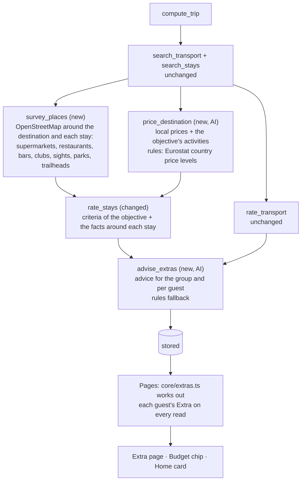

# PlanyTrip — The Extra page (plan to validate)

> **Status: Phase 8 done (T8.1 to T8.13, 2026-11-15): the budget counts the Extra, the Extra page shows it line by line, a Nature trip's rental car has a real price where DiscoverCars publishes one ([rental-sources.md](./rental-sources.md)), fuel is the EU Weekly Oil Bulletin's pump price, and the summary and its PDF freeze the Extra with the rest. Still open: D8 (leaving out part of the Plus for one guest); [task.md](./task.md) Phase 8 says what each task did.** The tasks are in [task.md](./task.md) Phase 8. **The exact rules are now use-cases.md R10 to R12, and the expected figures UC-D: where this plan and those differ, use-cases.md wins.** T8.1 made these more precise: the Catalan tax stops at 7 nights; the seasons swap south of the equator; at least one night out is kept; a Nature activity within 2 km is on foot; the rules give no group advice without the AI; `transit-not-taxi` only for a taxi the guest takes alone; `last_mile_eur` stays on the option for the comfort score, only its price moves.
> Companions: [task.md](./task.md) · [use-cases.md](./use-cases.md) · [architecture.md](./architecture.md) · [database.md](./database.md)
> The decisions are in **§13**: D1 to D7 are taken, D8 is still open.

---

## 1. What the Extra is

The Extra is the third part of a guest's budget, next to transport and housing: **the money spent once there.** It has two blocks.

- **Mandatory**: what every guest pays, whatever the trip is for.
  - Food: groceries and restaurants, from the local prices and from what is close to the stay.
  - Getting from the arrival airport or station to the stay, and back on the last day: public transport, or a taxi / ride-hailing car.
  - The tourist tax, when the stay's price does not already include it.
- **Plus**: what the trip is for. It is set by the destination's objective: **Partying, Chill, Culture, Nature or None**. The objective also changes **how stays are rated**: a central flat wins for Partying, a hotel with a spa wins for Chill.

On top of the figures, **the AI gives advice** on how to fit the Plus into the budgets:
- for one guest: "In Milan, Guest 2 should eat from the supermarket rather than in restaurants, to afford the nights out";
- for the whole group: "In London, go out once, all together, rather than every night".

**What already exists:**
- each destination already has an objective and a budget level (light, medium or high), chosen at step 2;
- the "Extra" chip on the Budget page is marked "soon";
- the Home page's "Extra" card says "Groceries | Party", with nothing behind it;
- the stay rating already receives the objective, but only as a vague last criterion.

---

## 2. Ground rules (how the app already works)

1. **The AI works while the trip is set up, never when a page is shown** (R9). What it gives is stored with a fingerprint: the local prices, the activities and the advice. When the inputs change, the page says "may be out of date" and offers a button. Nothing is asked of the AI until that button is pressed.
2. **No AI, still a figure.** If the AI is not available, rules give the amounts and the advice, marked "rule-based". The trip is never blocked.
3. **The Extra amounts are recomputed every time a page is read**, from stored data, by one function with no I/O (`core/extras.ts`), like the scenarios today. Putting the ❤ on another stay, or changing a budget, shows at once without asking the AI.
4. **Most Extra figures are estimates.** They are shown with ≈ and their source, like an estimated train price. A real price, such as an official tourist tax rate, is said to be real.
5. **A source behind a wall is not used, and never gone round.** Open data and plain HTTP come first, as for the trains.
6. **The Extra is worked out for one stay:** the group's ❤ stay for that destination, or the default one (R4) while there is no ❤. The ❤ on a stay is the group's vote (decision D1).

---

## 3. The workflow



**Order and why:**
1. The searches run first, unchanged.
2. Then two new steps run side by side for each destination:
   - **`survey_places`** looks at what is around the destination and around every stay found (one OpenStreetMap request per destination);
   - **`price_destination`** asks the AI for the local prices and for the objective's activities (one AI call per destination).
3. **`rate_stays`** then rates the stays with what those two steps found. A stay close to the bars is rated higher for Partying.
4. **`advise_extras`** comes last, because it needs the default stay and every guest's other costs (one AI call per destination).

**What it costs:**
- per destination: two more AI calls and one OpenStreetMap request;
- in time: roughly one to two more minutes for a trip of three destinations (each AI call takes about as long as a rating).

**After setup:**
- **A ❤ on another stay:**
  - the amounts move at once: food depends on the supermarkets around the new stay, the transfer and the tax on where it is;
  - the advice is flagged "may be out of date", with an **Ask again** button that queues `advise_extras` for that destination only.
- **A budget, the dates or the objective changes:** the same "may be out of date" and the same button.
- **The objective changes:** the stay ratings and the activities are out of date too. The banner offers **Re-rate**, as it already does for a budget change.

---

## 4. What is needed, and where it comes from

| Data | Used for | Source | Shown as |
|---|---|---|---|
| Where the stay is | everything below | Airbnb: already read. **Hotels: not known today** (T7.4 says so): read it from Google Hotels' page, or find the hotel by its name with Photon | — |
| The stay's amenities: kitchen, pool, sauna / hot tub / spa, view, free parking | food, Chill, Nature | Google Hotels: already read. **Airbnb: its listing page is already opened, but the amenities are not kept yet** | — |
| What is around the stay: the nearest supermarket, bars within 500 m, nightclubs and sights within 1 km; distance to the nightlife district, the historic centre, the nearest hiking path or natural park | food, every objective's rating | **OpenStreetMap, through the Overpass API** (done, T8.3): open data, free. One request per destination, kept a month. The nightlife district and the historic centre are where bars and sights are densest; distances as the crow flies | real |
| Local prices: groceries for a day, a cheap meal and a mid-range one, a drink in a bar, club entry, pre-drinks, a public transport ticket and day pass, a taxi's start fee and price per km, parking, a rental car for a day, fuel | every amount | **The AI, at setup**, for that city and season (done, T8.4). When the AI is not available: **Eurostat's price levels per country** (food, restaurants and hotels, recreation, alcohol, transport; EU average = 100) × base amounts in config | ≈ AI estimate / ≈ country average |
| Whether public transport runs at that hour (arriving at 23:40, back from a club at 03:00, to a trailhead at 08:00) | transfer, Partying, Nature | **Transitous**, from one point to another at a given time | real |
| Road distance from the stay to a trailhead or to the arrival station | taxi, fuel | **OSRM** | real |
| Fuel price in the country | Nature's cars, and car trips | **The EU Weekly Oil Bulletin**: Euro-super 95, taxes included, in the 27 EU countries. Car trips at the mean of the two ends' prices; outside the EU, the estimate (Nature) or 1.80 €/L (car trips) | real |
| Tourist tax rate | tax | France: **each commune's voted rate**. Elsewhere: a short table in config for the places met, plus the AI | real / ≈ |
| Whether the stay's price already includes the tax | tax | Airbnb's price breakdown on the listing page (to read, T8.2). Otherwise by provider and place | — |
| Activities: top sights, clubs, hikes, beaches, spas | Plus | **The AI, at setup**: name, price, duration, position, link. Each position is checked on OpenStreetMap or Photon, so a place the AI made up is dropped | ≈ |
| Rental car price | Nature | **DiscoverCars' published average** at the destination's airport for the stay's months, with a link to its page (T8.11, [rental-sources.md](./rental-sources.md)); the AI's estimate where it has none | ≈ published average / ≈ AI estimate |

---

## 5. Mandatory expenses

### 5.1 Food

```
meals(g)          = nights × 3
restaurant meals  = round(meals × restaurant share)
food(g)           = restaurant meals × local meal price  +  grocery meals × (local groceries per day / 3)
```

- **Meal price:** a cheap meal for a light or medium budget; a mid-range one for a high budget.
- **Restaurant share:** it starts from the objective, then moves with the budget level and the stay.

  | Objective | Starting share |
  |---|---|
  | None | 30 % |
  | Partying | 25 % |
  | Culture | 40 % |
  | Chill | 60 % (you asked for restaurants first) |
  | Nature | 15 % |

  Then:
  - **budget level:** light −15 points, high +20 points;
  - **no kitchen** (most hotels): breakfast at a café, and at least 2 meals in 3 eaten out;
  - **no supermarket within 1 km of the stay:** +15 points, because shopping is harder;
  - many restaurants close by changes nothing: that is what makes the share possible, not a reason to raise it.

Example with made-up prices, for the arithmetic only:
- the trip: 4 nights, medium budget, Culture, an Airbnb with a kitchen and a supermarket 300 m away;
- 12 meals at 40 % gives 5 restaurant meals and 7 grocery meals;
- at 15 € a cheap meal and 12 € of groceries a day (4 € a meal): 5 × 15 + 7 × 4 = **≈ 103 €**.

### 5.2 Getting to the stay and back

This is for each guest arriving by plane, train or bus: from the arrival airport or station to the stay, and back on the last day.

- **Public transport**, when Transitous finds a journey at the guest's arrival time that takes at most 90 minutes. The price is the local ticket, or the airport line's own fare when it has one.
- **Otherwise a taxi or ride-hailing car:**
  - the price is the OSRM distance × the local per-km price, plus the start fee;
  - it is shared by the guests who arrive together (same option, within 30 minutes), up to 4 per car;
  - a late arrival with no public transport left falls here on its own.
- **Guests coming by car** have no transfer. They pay **parking** instead, when the stay has no free parking: the local price per day × the nights.
- **A rental car picked up at the arrival station** (Nature, §6.4) is the transfer for its passengers.

**How it is known:** at setup, Transitous is asked once per arrival point and stay, at midday; the guest's own hour then decides (between 06:00 and 23:00 the bus, else a taxi), so a ❤ on another stay or journey moves the transfer at once.

**Today's `last_mile_eur` goes** (decision D3). It is a flat 11 € per 10 km, added to the transport only beyond 20 km, measured from the destination's centre rather than the stay. The transfer would be counted once, in the Extra, to the real stay. The transport card would then show the journey only.

### 5.3 Tourist tax

```
tax(g) = rate per person per night × nights      when the stay's price does not include it
```

- **The rate** depends on the place and the kind of stay (done, T8.5).
  - France: the commune's voted rate, found from the destination's point. A rental with no star rating pays a share of the price per person per night (Paris: 5 %, with the extra taxes ×3.25, at most €15.60).
  - Elsewhere: a short config table for the places in the trips (Barcelona €9.50 for a tourist flat, Lisbon €4, Porto €3, Prague about €2, Berlin 7.5 % of the price; Madrid, Andalusia and Finland have none), then the AI's figure.
  - The host's own figure, when they write one, comes first: it is what they will ask.
- **Whether it is already in the price:**
  - **Airbnb in France:** Airbnb collects the tax itself in the communes that tax "au réel" (it says more than 29,000), so it is in the price paid. In communes "au forfait", the host pays it, not the guest.
  - **Airbnb in Catalonia:** it depends on the listing (checked on real pages, T8.2). Airbnb collects it for some Barcelona listings (a "Taxes" line in the price details, already in the total); for others the host collects it at check-in, as you saw, and writes so in the description. So it is read for each listing.
  - **Hotels:** included. Google's policy is that a hotel's total includes every mandatory charge, city and tourism taxes too, "regardless of when they're due" ([Google](https://support.google.com/hotelprices/answer/6064432); checked in T8.2).
  - **Done:** Airbnb's price details list "Taxes" when Airbnb collects them, and hosts who collect it themselves say so in the description (often with the rate), so "included" is read for each offer. A host who says nothing leaves it unknown, and the place decides.
- Minors are exempt in most places, but the guest form has no age: every guest counts as an adult.
- On the page it is its own line, for example "Tourist tax ≈ 5 € a night × 4: paid to the host on arrival, not in the Airbnb price".

---

## 6. Plus expenses, by objective

| Objective | The stay rating rewards | Activities budget | Local transport | Food |
|---|---|---|---|---|
| **Partying** | central, close to the nightlife, safe to walk back at night; Airbnb over hotels | nights out: entry + drinks + pre-drinks + the way back | there by public transport, back by night bus or a shared taxi | 25 % restaurants |
| **Chill** | hotels with spa / wellness, pool in summer, sauna in winter, view, quiet | one paid relaxing activity; beaches and parks are free | day passes for a city visit | 60 % restaurants |
| **Culture** | close to the historic centre and the top sights | top 3 to 5 sights: museums, boats, viewpoints | depends on the distance to the historic centre | 40 % restaurants |
| **Nature** | close by road to hikes and parks, parking | hikes, beaches, parks (60 % of the days) | public transport if it reaches the trailhead, else cars: rental + fuel | 15 % restaurants |
| **None** | as today | none | a small allowance | 30 % restaurants |

### 6.1 Partying

**How stays are rated:**
- **Close to where young people go out**: the density of bars and clubs around the stay (OpenStreetMap), and the nightlife districts the AI names. Closeness to the centre counts too.
- **Safe to walk back at night**: the AI's knowledge of the neighbourhood, always with a concrete reason ("12 minutes on foot from the bars along busy streets"), never a vague "bad area". A stay far out with no night transport loses points.
- **Airbnb over hotels**: a whole home with a living room, where the group gathers before going out. Airbnb bans parties with outside guests; the group's own pre-drinks are fine, but a listing that says "no parties" or "quiet after 22:00" loses a little.

**Activities:**
- **Nights out:** one every two nights, rounded up (4 nights gives 2 nights out; decision D5).
- **Each night out, per person:**
  - the entry: a club, or 0 for a bars-only night;
  - about 4 drinks at the local bar and club price;
  - a share of the pre-drinks bought at the supermarket;
  - the way there: a public transport ticket;
  - the way back: the night bus when Transitous finds one at 03:00 from the nightlife area to the stay, otherwise a taxi shared by 4.

### 6.2 Chill

**How stays are rated:**
- **Hotels with a spa or wellness area** win (decision D4).
- **A pool** when the trip is in summer (June to September). **A sauna, hot tub or hammam** in winter (November to March). Both come from the amenities.
- **A view** (sea, mountains, "view" in the title or amenities), and **quiet**: not in the busiest nightlife streets (a high density of bars counts against the stay), and not necessarily in the centre.
- Words like calm, quiet, peaceful, cosy or relaxing in the title or the reviews.

**Activities:**
- Beaches, parks and walks are free.
- One paid relaxing activity per trip (a spa, thermal baths), at the AI's local price, when the stay has no spa of its own.
- One public transport day pass every three nights (at least one), in case the group visits the city.

**Food:** restaurants first (60 %).

### 6.3 Culture

**How stays are rated:**
- **Walking distance to the historic centre and to the top sights**, checked on OpenStreetMap. In Granada, a stay in the Albaicín or near the Alhambra beats one on the outskirts.

**Activities:**
- **The top 3 to 5 things to do** at that destination, chosen by the AI: about one per night, at least 3 and at most 5.
- For each one:
  - the adult price (0 for a free viewpoint);
  - how long it takes;
  - a booking note when it matters;
  - a free day when the AI knows one (free first Sunday of the month).

**Local transport:**
- historic centre within 1.5 km of the stay: on foot, 0 €;
- otherwise: a day pass for each day, at the local fare.

### 6.4 Nature

**How stays are rated:**
- **Close by road to the hikes and natural parks**: OSRM distance to the protected areas on OpenStreetMap and to the AI's top hikes.
- Parking at the stay.

**Activities:**
- **60 % hiking, 40 % rest**, as you asked: hike days = round(nights × 0.6). 4 nights gives 2 hike days, 5 nights 3, 7 nights 4.
- For each hike day, the AI picks a hike, a beach or a park: its name, difficulty, park and parking fees, and the position of its start.

**Getting to the trailhead:**
1. **Public transport** when Transitous finds a journey from the stay that takes at most 1.5 hours. The price is the local fares.
2. **Otherwise cars:**
   - **Guests who came by car bring their car first**: their seats are used before anything is rented.
   - **Rental cars** for the others: cars = ceil(people without a seat ÷ 5). A car is rented **for the whole stay**, at the arrival airport or station, so it is also their transfer (decision D6).
   - **Cost:** days × the daily rate, plus fuel (OSRM km from the stay to each trailhead and back × 6.5 L/100 km × the country's fuel price), plus parking fees. It is shared by the car's passengers.

**Where a rental price could come from (researched):**
- **Comparison sites:** their searches are behind bot protection or forbidden by their robots.txt. Tested on 2026-11-15 (T8.11, [rental-sources.md](./rental-sources.md)): Rentalcars.com is walled; DiscoverCars' place pages answer, and each airport page publishes the average daily price of every month, which the app now uses; Kayak answers with two months only.
- **Turo:** its own help pages list only North America and Australia, plus pages for London and Manchester. Nothing for continental Europe.
- **Getaround Europe**: France, Spain, Germany, Belgium, Norway and Austria, merging with GoMore in 2026. Probed: its robots.txt forbids its search; its city pages give "from" prices with no season. Not used.
- **So:** the daily rate is DiscoverCars' average at the airport for the stay's months, with a link to its page so a guest can check their own dates; where it has no page, the AI's estimate. Both are shown with ≈.
- **A note on the card:** a driver under 25 usually pays more, and a credit card is needed for the deposit. The app does not know ages.

**Food:** 15 % restaurants (picnics).

### 6.5 None

- The stay rating is as today.
- No activities.
- Local transport: a small allowance of 2 public transport tickets a night, because getting around is small and varies a lot.
- Food: 30 % restaurants.

---

## 7. The advice

**When:** at setup, after the ratings, because it needs the default stay. Again on **Ask again** when it is out of date.

**What the AI is given:**
- for each guest: the budget, transport, housing share, mandatory and Plus, and what is left;
- the objective;
- **the levers, each with the euros it saves, already worked out by the rules.**

The AI chooses and words; **it never does the arithmetic**, so every figure in the advice is exact.

**The levers:**
- more meals from the supermarket;
- one night out fewer, or a bars-only night;
- skip or swap the most expensive activity;
- public transport instead of a taxi;
- share a taxi;
- a free museum day;
- one rental car fewer, or fewer rental days;
- a cheaper stay from the list (the group's ❤).

**What comes back,** stored like the destination synthesis:
- **For the group:** up to 3 lines. "London: go clubbing once, all together; the second night is bars only (−22 € each)."
- **Per guest:** only for guests who are tight or over budget. "Guest 2: eat from the supermarket at lunch and dinner (−45 €) to afford both nights out."
- **Every piece of advice carries its lever and its saving**, so the page can show where the guest ends up: "after this advice: 410 € of 420 €".

**The tone:** practical, never judging a guest.

**Without the AI:** for each guest over budget, the rules apply the levers from the biggest saving down until the guest fits. The text comes from templates, marked "rule-based".

**Out of date when** a budget, the ❤ stay, the dates, an offer or the objective changes.

---

## 8. The budget with the Extra

Today (R5): `cost(g) = transport(g) + housing / guests`. Now: `cost(g) = transport(g) + housing / guests + mandatory(g) + plus(g)`.

**Decision D2: both count, but the Mandatory weighs more than the Plus.** The Plus is never the exact amount: it is a suggestion from the AI. My reading of that:

| | Mandatory | Plus |
|---|---|---|
| In the totals (cards, guest's cost, group total) | yes | yes, labelled "suggested by the AI" |
| Budget tier (R6) | counts fully | **can make a guest 🟡 "tight", never 🔴 on its own.** A guest is 🔴 only if transport + housing + mandatory is over the budget. |
| Recommendation (R7), "eligible" | counts | does not count. The Plus only breaks ties. |
| Advice | — | the levers to bring the Plus back inside the budget |

So a guest who is over budget only because of the nights out sees 🟡 and the advice ("one night out fewer, −52 €"), not a red "can't come".

**Consequence:** Martin's figures in UC-A (475 €) change. The `scenario-martin` seed gets local prices so the tests keep exact expected figures, and the acceptance criteria are updated in the same task.

**Elsewhere in the dashboard:**
- **The Budget page:** the "Extra" chip turns on. Its card shows the Extra's total and the share per guest, like Housing and Transports.
- **The Home card** shows two words that depend on the objective:

  | Objective | Home card |
  |---|---|
  | None | Groceries \| Transport |
  | Partying | Food \| Nights out |
  | Chill | Restaurants \| Relax |
  | Culture | Food \| Visits |
  | Nature | Food \| Hikes & car |

---

## 9. The Extra page

Route: `/trips/[tripId]/extra?dest=…`, reached from the Home "Extra" card and the Budget chip. The figures below are **illustrative only**: 4 guests, 4 nights.

```
┌ Extra · Barcelona · Partying · Medium budget ─────────── [ Guest: Everyone ▾ ] ┐
│ Worked out for the stay "Loft in El Born" ♥              ≈ estimates: sources  │
│                                                                                │
│ MANDATORY                                                 per guest    group   │
│   Food            12 meals: 9 groceries, 3 restaurants      ≈ 81 €    ≈ 324 €  │
│   Airport ↔ stay  airport bus, both ways                    ≈ 14 €     ≈ 56 €  │
│   Tourist tax     paid to the host, not in the Airbnb price ≈ 20 €     ≈ 80 €  │
│                                                                                │
│ PLUS · PARTYING                                                                │
│   2 nights out    club 15 € + 4 drinks + taxi back ÷ 4     ≈ 104 €    ≈ 416 €  │
│   Pre-drinks at the flat (supermarket)                      ≈ 10 €     ≈ 40 €  │
│   Metro to the bars                                          ≈ 5 €     ≈ 20 €  │
│                                                                                │
│ EXTRA                                                     ≈ 234 €    ≈ 936 €   │
│ Whole trip: Jessy 654 € of 600 € 🔴 · Martin 512 € of 800 € 🟢 · …             │
│                                                                                │
│ ADVICE  written by the AI at setup                       [ may be out of date ]│
│   Everyone: one club night in El Born; the second night is bars only (−15 €).  │
│   Jessy: supermarket for every meal (−33 €) and the night bus home (−5 €):     │
│          with the group's advice, 601 € of 600 €.                              │
└────────────────────────────────────────────────────────────────────────────────┘
```

- **Each line opens its detail:** the formula, the local prices used, and where each one comes from.
- **One guest's view** shows their own lines: their transfer depends on their arrival, and whether they came by car.
- **Not in this phase:** changing the plan by hand, for example removing an activity or choosing one night out (decision D8, still open).

---

## 10. Data and jobs

**New tables**:

| Table | Holds |
|---|---|
| `destination_prices` | `destination_id`, `payload_json` (each local price: amount, unit, source `ai` / `rules` / `open-data`, note), `input_hash`, `created_at` |
| `extra_activities` | `destination_id`, `objective`, `name`, `kind` (club, museum, hike, beach, spa…), `price_eur` per person, `duration_h`, `lat`, `lon`, `url`, `needs_car`, `source`, `created_at` |
| `place_surveys` | `stay_option_id`, `facts_json` (counts within 500 m and 1 km by kind, nearest supermarket, distance to the centre, the historic centre and the nightlife area, nearest park or trailhead by road, amenities), `fetched_at` |
| `extra_advice` | `destination_id`, `payload_json`, `input_hash`, `source` `ai` / `rules`, `created_at` |

`destinations` needs nothing new: the objective and the budget level are already there.

**New jobs:**
- `survey_places`, `price_destination` and `advise_extras` are added to `JOB_TYPES`.
- `compute_trip` queues them.
- The computing screen shows them.
- A failed survey or price pass appears in the "failed searches" banner with **Search again**, like T7.7.

**New code:**
- `scrapers/places/overpass.ts`: the OpenStreetMap queries;
- `ai/extra-prices.ts` and `ai/extra-advice.ts`: prompts, answer schemas, checks;
- `core/extras.ts`: the plan and the amounts per guest, with no I/O;
- `core/ratings.ts`: gains the objective's criteria;
- `server/services/extraView.ts`: `getExtraView`, with `lib/extraLines.ts` for each line's words;
- the page, plus components `ExtraBreakdown`, `ExtraGuestView` and `ExtraAdvicePanel`.

---

## 11. Numbers to adjust (`config.extras`)

| Setting | Proposed default |
|---|---|
| Meals per night | 3 |
| Restaurant share: None / Partying / Culture / Chill / Nature | 30 / 25 / 40 / 60 / 15 % |
| Budget level effect on the share: light / medium / high | −15 / 0 / +20 points (high uses mid-range meals) |
| Supermarket "close to the stay" | within 1 km, else +15 points |
| No kitchen | breakfast out, at least 67 % restaurants |
| Transfer by public transport | if a journey of at most 90 min exists at the arrival time |
| Taxi | up to 4 per car, guests arriving within 30 min share it |
| Partying: nights out / drinks per night / taxi share | 1 per 2 nights (rounded up) / 4 / 4 people |
| Partying: night transport checked at | 03:00 |
| Chill: summer / winter months | June–September / November–March |
| Chill: day passes | 1 per 3 nights, at least 1 |
| Culture: activities | about 1 per night, at least 3, at most 5 |
| Culture: walkable historic centre | within 1.5 km |
| Nature: hike days | 60 % of the nights |
| Nature: public transport to a trailhead | if it takes at most 1.5 h |
| Nature: seats per car / consumption | 5 / 6.5 L per 100 km |
| None: public transport tickets | 2 per night |
| Rules fallback rating: weight of the objective's criteria | 25 % of the score |

---

## 12. Task plan (Phase 8, proposed)

- [x] **T8.1 Rules and expected figures.** Write R10, R11 and R12 in `use-cases.md`, update R5 to R7 after D2, and give the `scenario-martin` seed its local prices. Done when: the tests that state the Extra figures exist (failing).
- [x] **T8.2 What is known about a stay.** Airbnb: keep the amenities and read the price breakdown (tax included or not). Hotels: their position. Done when: a Barcelona Airbnb and a Barcelona hotel each carry a position, amenities and "tax included: yes / no".
- [x] **T8.3 Around each stay, from OpenStreetMap.** `scrapers/places/overpass.ts`, the `survey_places` job, the `place_surveys` table. Done when: Barcelona's stays have their counts and distances stored, from one request per destination, kept a month.
- [x] **T8.4 Local prices and activities.** The `price_destination` job, the `destination_prices` and `extra_activities` tables, activity positions checked. Done when: Barcelona (Partying), Granada (Culture) and Le Mont-Saxonnex (Nature) get prices and activities; without the AI, Barcelona gets country-average prices marked "rule-based".
- [x] **T8.5 Tourist tax.** France's open data, the config table, the "included" flag. Done when: an Airbnb in Catalonia adds the tax and an Airbnb in Paris does not.
- [x] **T8.6 `core/extras.ts`.** Mandatory and Plus for each objective, transfers checked with Transitous, cars and fuel. Done when: the seed's figures are exact, and a ❤ on another stay moves the Extra at once.
- [x] **T8.7 Stay ratings that follow the objective.** The rating prompt and the rules. Done when: on the same stays, Partying puts the central flat first and Chill the hotel with a spa, and None changes nothing.
- [x] **T8.8 The advice.** The `advise_extras` job, the `extra_advice` table, the "out of date" flag, the rules fallback. Done when: a guest over budget gets levers whose savings, applied, make them fit, and a ❤ on another stay marks the advice out of date.
- [x] **T8.9 The budget.** `cost(g)` with the Extra (per D2), the Budget chip turned on, the Home card's words, the recommendation.
- [x] **T8.10 The Extra page**, with each guest's view and each line's detail.
- [x] **T8.11 A real rental car price.** Probe Getaround Europe: real prices if it answers plain requests, an estimate if it is walled. Done when: a note says what answered and what did not, as `train-sources.md` does.
- [x] **T8.12 Fuel prices from the EU Weekly Oil Bulletin** (optional): Nature's cars, and car trips too.
- [x] **T8.13 The summary and its PDF include the Extra**, frozen at validation like the rest.

**Not in this phase:** changing the plan by hand, booking anything, the guests' ages.

---

## Sources consulted (2026-11-13)

- Airbnb and the French tourist tax: [Airbnb help, collection in France](https://www.airbnb.gy/help/article/2284), [Airbnb help, where it collects](https://fr.airbnb.ch/help/article/653), [Airbnb newsroom, 2025 figures](https://news.airbnb.com/fr/taxe-de-sejour-levier-de-developpement-pour-les-communes-et-intercommunalites-face-aux-contraintes-budgetaires-croissantes/), [Connexion: is it collected on a French Airbnb?](https://www.connexionfrance.com/practical/is-tourist-tax-collected-when-staying-in-a-french-airbnb/675986)
- Catalonia's tax: [Hostaway, Barcelona](https://www.hostaway.com/fr/vacation-rental-guide/tourist-tax/spain/barcelona/), [Holidu, Catalonia 2026](https://www.holidu.fr/magazine/hausse-de-la-taxe-de-sejour-en-catalogne-guide-pour-les-hotes), [Airbnb newsroom, Spain](https://news.airbnb.com/airbnb-ready-to-collect-the-tourist-tax-in-spain/)
- French rates as open data: [data.gouv.fr, who levies it, commune by commune](https://www.data.gouv.fr/datasets/taxe-de-sejour-la-collectivite-qui-la-percoit-commune-par-commune), [data.gouv.fr, rates by commune 2026](https://www.data.gouv.fr/reuses/taxe-de-sejour-par-commune-2026), [collectivites-locales.gouv.fr](https://www.collectivites-locales.gouv.fr/taxe-de-sejour)
- Price levels: [Eurostat, comparative price levels](https://ec.europa.eu/eurostat/statistics-explained/index.php/Comparative_price_levels_of_consumer_goods_and_services), [DBnomics, prc_ppp_ind](https://db.nomics.world/Eurostat/prc_ppp_ind)
- OpenStreetMap: [Overpass API and its usage policy](https://wiki.openstreetmap.org/wiki/Overpass_API)
- Fuel: [EU Weekly Oil Bulletin](https://energy.ec.europa.eu/data-and-analysis/weekly-oil-bulletin_en)
- Rental cars:
  - [Turo, where it operates](https://help.turo.com/en_us/available-cars-HJZZVNgE9.md)
  - [Getaround Europe and GoMore merge (tech.eu, May 2026)](https://tech.eu/2026/05/05/getaround-europe-and-gomore-merge-to-create-europes-largest-peer-to-peer-carsharing-network/)
  - bot protection on [Rentalcars.com](https://scrape.do/blog/rentalcars-scraping) and [DiscoverCars](https://scrape.do/blog/discovercars-scraping)
