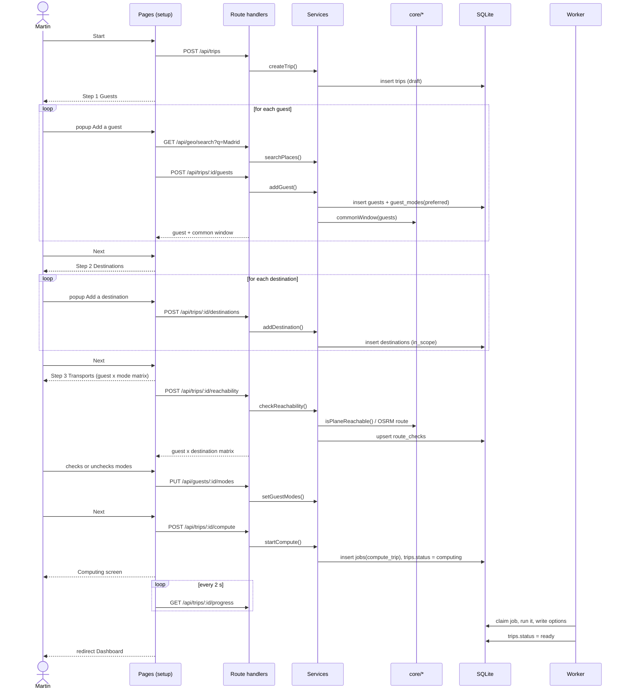
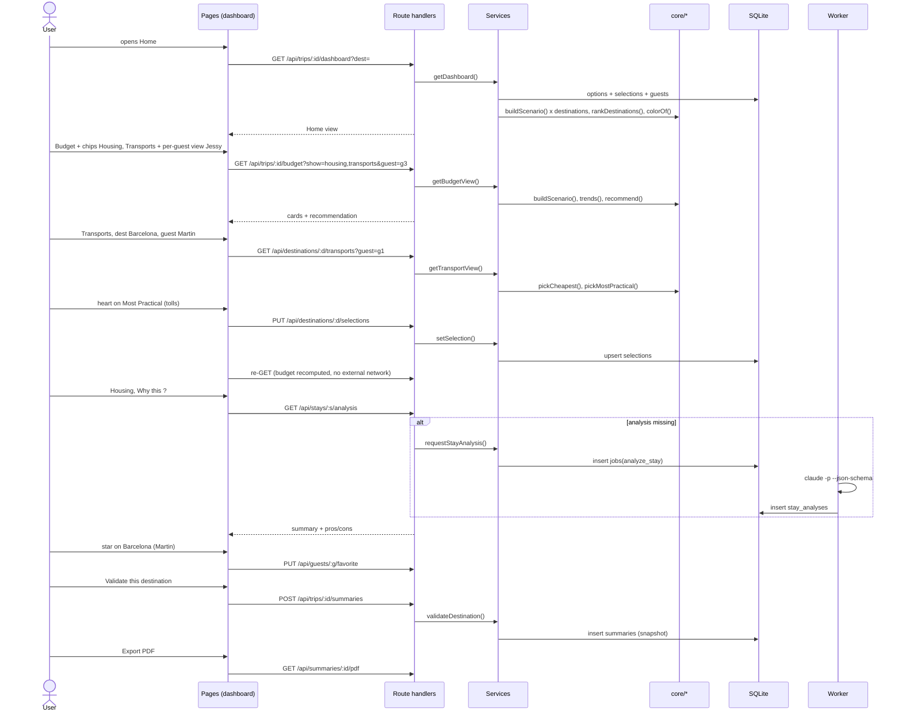

# PlanyTrip — POC tasks

> Companions: [use-cases.md](./use-cases.md) · [architecture.md](./architecture.md) · [database.md](./database.md)

## 0. POC goal

**The POC is done when use case UC-A (Martin) passes end to end**, with the `scenario-martin` seed:
wizard → compute → dashboard → ❤ "with tolls" → the figures from UC-A §A.4 are displayed.

| Building block | POC | After the POC |
|---|---|---|
| Car | **real** (Photon + OSRM, free, no scraping) | carpooling |
| Flights, stays | **fake adapters** returning the fixtures from use-cases.md §1.3 | real Playwright adapters (phase 7) |
| AI | real `claude -p` on stays (phase 6) | adjusting transport ranking based on `reason` |
| UC-B, UC-C | the UI already supports them; their criteria become the next tests | — |

Each task lists: **files**, **functions or endpoints** created, and **done when**.

---

## 1. Conventions

- **Layers:** `app/` → `server/services/*` → `core/*`. The `worker/` uses the same services.
- **One service function = one endpoint.** Pages can call a service directly or through the endpoint (client). Example: `POST /api/trips/:tripId/guests` → `addGuest(tripId, input)`.
- **Validation:** every endpoint input has a Zod schema in `src/server/schemas.ts`.
- **Errors:** `{ error: { code: string, message: string, field?: string } }` with status 400 (validation), 404, 409 (conflict, e.g. empty common window) or 500.
- **Amounts:** whole euros in the database. Computations in `number`, rounding only at display time (`formatEur`).
- **Tests:** Vitest. Every acceptance criterion in use-cases.md becomes a test on the seed (`tests/scenario-martin.test.ts`).

---

## 2. Flow A — Trip setup

Chosen order: **Guests → Destinations → Transports.** The Transports step comes last because it shows guest × destination reachability, which needs the two previous steps.



| Step | User action | Endpoint | Service | Computation (`core`) |
|---|---|---|---|---|
| A1 | Start | `POST /api/trips` | `createTrip()` | — |
| A2 | Type the city (autocomplete) | `GET /api/geo/search?q=` | `searchPlaces(q)` | — |
| A3 | Enter (guest popup) | `POST /api/trips/:tripId/guests` | `addGuest()` | `commonWindow()` |
| A3' | Edit / delete a guest | `PATCH` / `DELETE /api/guests/:guestId` | `updateGuest()` / `deleteGuest()` | `commonWindow()` |
| A4 | Enter (destination popup) | `POST /api/trips/:tripId/destinations` | `addDestination()` | `isInScope()` |
| A4' | Edit / delete a destination | `PATCH` / `DELETE /api/destinations/:destinationId` | `updateDestination()` / `deleteDestination()` | — |
| A5 | Landing on step 3 | `POST /api/trips/:tripId/reachability` | `checkReachability()` | `reachabilityMatrix()` |
| A6 | Check a mode / "Add plane" | `PUT /api/guests/:guestId/modes` | `setGuestModes()` | `reachabilityMatrix()` |
| A7 | Next (start the computation) | `POST /api/trips/:tripId/compute` | `startCompute()` | — |
| A8 | Computing screen | `GET /api/trips/:tripId/progress` | `getProgress()` | — |

---

## 3. Flow B — Dashboard and filters



### How filters work

| Filter | Where | Parameter | Effect | External network |
|---|---|---|---|---|
| Destination selector | Home, Housing, Transports | `dest=<id>` | picks the displayed destination | no |
| Dates / Housing / Transports chips | Budget | `show=dates,housing,transports` (multi) | adds the matching section to each card | no |
| Extra chip | Budget | — | disabled, "coming soon" tooltip | — |
| Per-guest view | Budget, Transports | `guest=<id>` or absent (= all) | Budget: the guest's actual cost instead of the average, colors based on their budget. Transports: the guest's origin. | no |
| Stay source | Housing | `provider=airbnb\|booking` (one column each) + `cursor` | paginated carousel per column | no |
| "More" sort | Transports | `sort=price\|duration\|depart` + `mode=` | full list for one mode, 🔴 at the end of the list | no |
| Include uncomfortable | Transports › More | `includeRed=1` | shows 🔴 options (default: at the end of the list, greyed out) | no |

All filters live in the URL (`useSearchParams`). A shared link or a reload gives the same view. No filter triggers scraping: only "Recompute" and "Why this ?" create jobs.

| Step | User action | Endpoint | Service | Computation (`core`) |
|---|---|---|---|---|
| B1 | Open Home | `GET /api/trips/:tripId/dashboard?dest=` | `getDashboard()` | `buildScenario`, `rankDestinations`, `colorOf` |
| B2 | Budget + chips + per-guest view | `GET /api/trips/:tripId/budget?show=&guest=` | `getBudgetView()` | `buildScenario`, `trends`, `recommend` |
| B3 | Housing | `GET /api/destinations/:destinationId/stays?provider=&cursor=` | `listStays()` | `pickDefaultStay`, `colorOf` |
| B4 | Compare | `GET /api/destinations/:destinationId/stays/compare?ids=a,b,c` | `compareStays()` | `scenarioWithStay()`: each offer as its ❤ would be, its Extra included (T8.9) |
| B5 | Why this ? | `GET /api/stays/:stayId/analysis` (the service creates the job if needed) | `getOrRequestStayAnalysis()` | — |
| B6 | Transports | `GET /api/destinations/:destinationId/transports?guest=&mode=&sort=&includeRed=` | `getTransportView()` | `pickCheapest`, `pickMostPractical`, `comfortOf` |
| B7 | ❤ (set / remove) | `PUT` / `DELETE /api/destinations/:destinationId/selections` | `setSelection()` / `clearSelection()` | — |
| B8 | ★ vote | `PUT /api/guests/:guestId/favorite` | `setFavoriteDestination()` | — |
| B9 | Recompute | `POST /api/trips/:tripId/compute?force=0\|1` | `startCompute()` | — |
| B10 | Validate | `POST /api/trips/:tripId/summaries` | `validateDestination()` | `buildScenario` (snapshot) |
| B11 | Summary / PDF | `GET /api/summaries/:summaryId` · `GET /api/summaries/:summaryId/pdf` | `getSummary()` / `renderSummaryPdf()` | — |
| B12 | Extra (line by line, everyone or one guest) | `GET /api/trips/:tripId/extra?dest=&guest=` | `getExtraView()` | `extraPlan`, `lineDetail` (lib/extraLines.ts) |
| B13 | Extra › Ask again | `POST /api/destinations/:destinationId/extra-advice` (and `GET` while it is written) | `askExtraAdvice()` / `extraAdviceStatus()` | — (the `advise_extras` job) |

---

## 4. API reference

| Method | Route | Body / query (Zod) | Response |
|---|---|---|---|
| POST | `/api/trips` | `{ name? }` | `Trip` |
| GET | `/api/trips/:tripId` | — | `Trip & { guests, destinations, commonWindow }` |
| PATCH | `/api/trips/:tripId` | `{ name?, nights? }` | `Trip` |
| GET | `/api/geo/search` | `?q=string(min 2)` | `GeoPlace[]` (max 5) |
| POST | `/api/trips/:tripId/guests` | `GuestInput { name, homeQuery\|homePlace, maxBudgetEur, availableFrom, availableTo, preferredMode }` | `{ guest, commonWindow }` |
| PATCH | `/api/guests/:guestId` | `Partial<GuestInput>` | `{ guest, commonWindow }` |
| DELETE | `/api/guests/:guestId` | — | `{ commonWindow }` |
| PUT | `/api/guests/:guestId/modes` | `{ modes: TransportMode[] (min 1) }` | `{ modes, matrix }` |
| PUT | `/api/guests/:guestId/favorite` | `{ destinationId \| null }` | `Guest` |
| POST | `/api/trips/:tripId/destinations` | `DestinationInput { query\|place, budgetLevel, objective, dateFrom?, dateTo? }` | `Destination` |
| PATCH / DELETE | `/api/destinations/:destinationId` | `Partial<DestinationInput>` | `Destination` / `204` |
| POST | `/api/trips/:tripId/reachability` | — | `ReachabilityMatrix` |
| POST | `/api/trips/:tripId/compute` | `?force=0\|1` | `{ jobId }` (409 if empty window or 0 destinations) |
| GET | `/api/trips/:tripId/progress` | — | `{ status, steps: { label, done, total, state }[] }` |
| GET | `/api/trips/:tripId/dashboard` | `?dest=` | `DashboardView` |
| GET | `/api/trips/:tripId/budget` | `?show=dates,housing,transports,extra&guest=` | `BudgetView` |
| GET | `/api/trips/:tripId/extra` | `?dest=&guest=` | `ExtraView` |
| GET | `/api/destinations/:destinationId/extra-advice` | — | `{ exists, pending, stale, source }` (409 if the trip was not worked out) |
| POST | `/api/destinations/:destinationId/extra-advice` | — | `202 { queued }`: false when it is already being written |
| GET | `/api/destinations/:destinationId/stays` | `?provider=&cursor=&limit=5` | `{ items: StayCard[], nextCursor }` |
| GET | `/api/destinations/:destinationId/stays/compare` | `?ids=` (2–3) | `StayComparison` |
| GET | `/api/stays/:stayId/analysis` | — | `{ state: 'ready'\|'pending'\|'unavailable', analysis? }` |
| GET | `/api/destinations/:destinationId/transports` | `?guest=&mode=&sort=&includeRed=` | `TransportView` |
| PUT | `/api/destinations/:destinationId/selections` | `{ kind, optionId, guestId?, reason? }` | `{ selection, budget: BudgetDelta }` |
| DELETE | `/api/destinations/:destinationId/selections` | `{ kind, guestId? }` | `{ budget: BudgetDelta }` |
| POST | `/api/trips/:tripId/summaries` | `{ destinationId }` | `Summary` |
| GET | `/api/summaries/:summaryId` | — | `Summary` |
| GET | `/api/summaries/:summaryId/pdf` | — | `application/pdf` |

`BudgetDelta = { perGuest: { guestId, before, after, tier }[], totalBefore, totalAfter, warnings: string[] }` feeds the "Jessy +70 €" toast.

---

## 5. Function reference

### `src/core/` (pure, tested)
```ts
// dates.ts
commonWindow(guests: Guest[], dest?: Destination): DateRange | null
nightsBetween(range: DateRange): number
limitingGuests(guests: Guest[], range: DateRange): Guest[]          // "limited by Martin"

// reachability.ts
isInScope(place: { countryCode, lat, lon }): boolean                // Europe for the POC: country AND position (La Réunion is reported as "FR")
isPlaneReachable(from: GeoPlace, to: GeoPlace): boolean             // airports within ≤ 150 km
reachabilityMatrix(guests, guestModes, destinations, checks): ReachabilityMatrix
fallbackMode(guest, accepted, destination, checks, options?): TransportMode | null

// comfort.ts
comfortOf(option: TransportOption, routeFastestMin: number): { level: Color; score: number; reasons: string[] }
needsOvernightStop(option: TransportOption): boolean

// pricing.ts
transportCostFor(option: TransportOption, occupants?: number, lastMile?: boolean): number   // the last mile only while the Extra does not count (T8.9)
guestCost(option: TransportOption, stay: StayOption | null, groupSize: number): number
budgetTier(cost: number, maxBudget: number): 'comfy' | 'limited' | 'over'      // without the Extra; with it: budgetTierWithExtra (extras.ts)
budgetDelta(before: Scenario, after: Scenario): BudgetDelta                     // what a ❤ did

// scenario.ts
pickCheapest(options: TransportOption[]): TransportOption | null          // R3: excluding 🔴
pickMostPractical(options: TransportOption[]): TransportOption | null
pickDefaultStay(stays: StayOption[], analyses: Map<string, StayAnalysis>, groupSize: number): StayOption | null
buildScenario(input: { destination, guests, guestModes, options, stays, analyses, selections, checks }): Scenario

// recommend.ts
rankDestinations(scenarios: Scenario[], votes: Map<string, number>): RankedDestination[]
explainBlockers(scenario: Scenario): string[]                         // "Jessy +90 €", "Martin ⛔"

// trends.ts
trends(values: Record<destinationId, number>): Record<destinationId, '▲' | '▼' | '≈'>

// colors.ts
colorOf(metric: 'budget' | 'comfort' | 'relativePrice' | 'dates' | 'aiVerdict', value: unknown, ctx?: unknown): 'green' | 'yellow' | 'red' | 'neutral'
```

### `src/server/services/`
`trips.ts` (createTrip, getTrip, updateTrip) · `geo.ts` (searchPlaces, resolvePlace) · `guests.ts` (addGuest, updateGuest, deleteGuest, setGuestModes, setFavoriteDestination) · `destinations.ts` (addDestination, updateDestination, deleteDestination) · `reachability.ts` (checkReachability) · `compute.ts` (startCompute, getProgress) · `dashboard.ts` (getDashboard, getBudgetView, getTransportView) · `stays.ts` (listStays, compareStays, getOrRequestStayAnalysis) · `selections.ts` (setSelection, clearSelection) · `summaries.ts` (validateDestination, getSummary, renderSummaryPdf)

### `src/worker/`
```ts
runWorker(): Promise<never>                       // loop: claimNextJob → handler → completeJob | failJob
claimNextJob(): Job | null                        // UPDATE … WHERE status='queued' AND run_after<=now LIMIT 1 RETURNING *
reportProgress(jobId, step: string, done: number, total: number): void
handlers: {
  compute_trip(job)      // route_checks → enqueue search_* → wait (re-entrant: returns { rescheduleInMs } instead of blocking, a single-slot worker would deadlock) → status ready. `analyze_stay` is asked for on demand ("Why this?"), not by the computation, so the subscription is only spent when someone looks
  search_transport(job)  // payload { destinationId, originKey, mode } → adapter(s) → transport_options
  search_stays(job)      // payload { destinationId } → adapter(s) → stay_options
  analyze_stay(job)      // payload { stayId } → askClaude(stayPrompt, StayAnalysisSchema) → stay_analyses
}
```

### `src/scrapers/` and `src/geo/`
```ts
interface TransportAdapter { id: string; modes: TransportMode[]; search(q: TransportQuery): Promise<TransportOptionInput[]> }
interface StayAdapter { id: string; search(q: StayQuery): Promise<StayOptionInput[]> }
carAdapter: TransportAdapter                       // valhallaRoute(from, to, { avoidTolls }) → standard | tolls + no_tolls (+ overnight_stop); OSRM fallback over 1,500 km
fixtureFlightsAdapter, fixtureStaysAdapter         // read src/db/seed/fixtures.ts (POC)
withCache<T>(key, ttlMs, fn): Promise<T>           // scrape_cache
throttle(domain): Promise<void>                    // 1 req / 3–5 s + jitter
geocode(q): Promise<GeoPlace[]>                    // Photon (OSM autocomplete), 1 req/s, geo_cache (30 days)
nearbyAirports(lat, lon, radiusKm = 150): string[] // data/airports.csv
osrmRoute(from, to, opts): Promise<{ distanceKm, durationMin } | null>  // null = no road (no route, or a point snapped > 25 km away: islands). No tollKm: the public server gives no road classes
```

### `src/ai/`
```ts
askClaude<T>(prompt: string, schema: z.ZodType<T>, opts?: { timeoutMs?: number }): Promise<T>
stayAnalysisPrompt(stay: StayOption, ctx: { objective, groupSize, nights }): string
StayAnalysisSchema = z.object({ verdict: z.enum(['good','ok','bad']), fitScore: z.number().int().min(0).max(100), pros: z.array(z.string()).max(5), cons: z.array(z.string()).max(5), summary: z.string().max(800) })
```

---

## 6. Task plan

### Phase 0 — Project
- [ ] **T0.1 Create the project.** Files: Next.js project, `package.json`. Done when: `npm run dev` starts both the web app and the worker.
- [x] **T0.2 Config.** Files: `src/config.ts`. Done when: every constant from use-cases.md §2 lives here and nowhere else.
- [x] **T0.3 Static data.** Files: `scripts/fetch-airports.ts` → `data/airports.csv` (OurAirports, `large` and `medium` airports). Done when: `nearbyAirports(40.4, -3.7)` contains `MAD`.

### Phase 1 — Foundations
- [x] **T1.1 Schema.** Files: `src/db/schema.ts`, `src/db/client.ts`. Content: every table and index from database.md. Done when: `npm run db:generate && npm run db:migrate` creates `data/trip.db`.
- [x] **T1.2 Types and Zod schemas.** Files: `src/core/types.ts`, `src/server/schemas.ts`. Done when: the model types and the API inputs from §4 exist.
- [x] **T1.3 Scenario seed.** Files: `src/db/seed/scenario-martin.ts`, `src/db/seed/fixtures.ts`. Command: `npm run db:seed`. Done when: the trip, the 3 guests and the 3 destinations exist in the database.
- [x] **T1.4 `core/dates.ts` + tests.** Done when: `commonWindow` gives 26/08 → 05/09, 10 nights, and `limitingGuests` = [Martin].
- [x] **T1.5 `core/comfort.ts` + tests.** Done when: every "Comfort" row of the §1.3 table is reproduced (including 910 € → 🔴 and Mont-Saxonnex with tolls → 🔴).
- [x] **T1.6 `core/pricing.ts` + `core/scenario.ts` + tests.** Done when: `buildScenario` produces the per-guest costs of tables A.2, B.2 and C.2 from the fixtures, and the ❤ "with tolls" gives Martin = 475 €.
- [x] **T1.7 `core/recommend.ts`, `trends.ts`, `colors.ts` + tests.** Done when: the rank and eligibility from C.2 are exact, with Barcelona recommended despite Chloé's ★.

### Phase 2 — Flow A: setup (UI + API)
- [x] **T2.1 Layout and landing page.** Files: `app/page.tsx`, base components (`GlassCard`, `PillField`, `ProgressBar`). Done when: Start → `POST /api/trips` → redirect to step 1.
- [x] **T2.2 Geo.** Files: `src/geo/geocode.ts`, `services/geo.ts`, `app/api/geo/search/route.ts`. Done when: "Madr" suggests Madrid with `airports: ['MAD']`.
- [x] **T2.3 Step 1 Guests.** Files: `setup/guests/page.tsx`, `GuestDialog`, `GuestRow`, `services/guests.ts`, guests routes. Done when: criterion A.4 #1 and validations A-S1 / A-S2.
- [x] **T2.4 Step 2 Destinations.** Files: `setup/destinations/page.tsx`, `DestinationDialog`, `services/destinations.ts`, routes. Done when: La Réunion shows the "Outside Europe" badge.
- [x] **T2.5 OSRM and reachability.** Files: `src/geo/osrm.ts`, `core/reachability.ts`, `services/reachability.ts`, route. Done when: Madrid → La Réunion by car = `no_road_route`, Madrid → Barcelona ≈ 620 km.
- [x] **T2.6 Step 3 Transports.** Files: `setup/transports/page.tsx`, `ModeMatrix`, `ReachabilityPreview`, `PUT /api/guests/:id/modes`. Done when: criterion A.4 #2 (⛔ + "Add plane"), and adding the plane turns the cell ✅.

### Phase 3 — Computation (worker)
- [x] **T3.1 Job queue.** Files: `worker/index.ts`, `worker/queue.ts`. Done when: a manually inserted job goes `queued → running → done`, and a failing job is retried 2 times with backoff.
- [x] **T3.2 Real car adapter.** Files: `scrapers/transport/car.ts`. Done when: `tolls` and `no_tolls` variants for Madrid → Barcelona and Madrid → Mont-Saxonnex, plus `overnight_stop` generated for Mont-Saxonnex (A-S5, A-S6).
- [x] **T3.3 Fake adapters.** Files: `scrapers/transport/fixture-flights.ts`, `scrapers/stays/fixture-stays.ts`. Done when: they return exactly the fixtures for the scenario's pairs.
- [x] **T3.4 `compute_trip` orchestration.** Files: `worker/handlers/*`, `services/compute.ts`, `compute` and `progress` routes. Done when: after Next on step 3, `trips.status = ready` and every option is in the database.
- [x] **T3.5 Computing screen.** Files: `setup/computing/page.tsx`. Done when: progress per step and per source is displayed, then the checkmark, then the redirect.

### Phase 4 — Flow B: dashboard
- [x] **T4.1 Dashboard layout.** Files: `(dashboard)/layout.tsx`, `Sidebar`, `DestinationSelect`, `TierBadge`, `ColorText`. Done when: Home / Destinations / Guests / Settings navigation works.
- [x] **T4.2 Home.** Files: `(dashboard)/page.tsx`, `services/dashboard.ts#getDashboard`, route. Done when: Budget / Housing / Transports cards and the guest list (tier, dates, ★) for the chosen destination.
- [x] **T4.3 Budget + filters.** Files: `budget/page.tsx`, `FilterChips`, `GuestViewSelect`, `RecommendationBanner`, `getBudgetView`. Done when: criteria C.4 #1 to 4.
- [x] **T4.4 Transports.** Files: `transports/page.tsx`, `TransportColumn`, `TransportCard`, `MoreSheet`, `getTransportView`. Done when: criterion B.4 #2 and guest selector A-S8.
- [x] **T4.5 ❤ selections.** Files: `services/selections.ts`, `selections` route, `HeartButton`, `BudgetToast`. Done when: **criteria A.4 #4 and #5 → the POC is validated.**
- [x] **T4.6 Housing.** Files: `housing/page.tsx`, `StayColumn`, `StayCard`, `CompareDialog`, `listStays`, `compareStays`. Done when: B-S4, B-S5, B-S7 and B-S8, and criterion B.4 #3.
- [x] **T4.7 ★ votes.** Files: `PUT /api/guests/:id/favorite`, `StarButton`. Done when: ★ counters are displayed on Budget and taken into account in the ranking (C-S5).
- [x] **T4.8 Destinations (deliberation).** Files: `destinations/page.tsx`, `services/deliberation.ts`, `core/preferences.ts`, `DestinationsPage`, `GuestMatrix`, `DestinationCard`, `DestinationDialog`, `VerdictBanner`, `TripMap`, `lib/tripMap.ts`, and for the AI toggle `ai/claude.ts`, `ai/destination-synthesis.ts`, `services/synthesis.ts`, `synthesize_destinations` job, `GET/POST /api/trips/:id/synthesis`, table `destination_syntheses`. Done when: the page compares every destination side by side with a guest × destination matrix (cost, share of budget, mode, ★, best fit, "wants it but can't afford it"), the ★ can be put and taken off from the matrix, an optional map shows who could go where, and the AI toggle gives the AI's pick with reasons, saying when it is out of date.

### Phase 5 — Validation and PDF
- [x] **T5.1 Validate a destination.** Files: `services/summaries.ts`, `summaries` route, `summary/page.tsx`. Done when: C-S7.
- [x] **T5.2 PDF.** Files: `GET /api/summaries/:id/pdf`. Done when: criterion C.4 #5.

### Phase 6 — AI (Claude)
- [x] **T6.1 `askClaude`.** Files: `src/ai/claude.ts`. First check the structured output field with `claude -p "say hello" --output-format json --json-schema '{"type":"object","properties":{"msg":{"type":"string"}},"required":["msg"]}'`. Done when: the call returns an object validated by Zod, with a timeout and 1 retry.
- [x] **T6.2 Stay analysis.** Files: `ai/prompts/stay-analysis.ts`, `worker/handlers/analyze-stay.ts`, `getOrRequestStayAnalysis`, `WhyThisPanel`. Done when: criterion B.4 #4, cache by `input_hash`, and an "unavailable" state if `claude` is missing. *(Since T6.3 it explains the score the stay was rated at setup, it no longer scores.)*
- [x] **T6.3 The AI curates what was scraped, at setup (not in the dashboard).** A scraper returns whatever the site gives, some of it poor or beside the point, so the AI rates every accommodation and every journey of a destination **while the trip is set up**, judged against the others and the group's budgets, and the scores are stored. **The dashboard only reads them and never calls the AI**, except on "Why this?". Files: `ai/option-ratings.ts`, `core/ratings.ts`, `services/ratingInputs.ts` + `services/ratings.ts`, `worker/handlers/rate-options.ts`, tables `option_ratings` and `rating_runs` (migration `0002_option_ratings`), `core/scenario.ts`, `RatingChip`, `RatingNotice`, `RecomputeButton` mode `ratings`. Done when: (1) every stay and journey of a destination is rated by one AI question and the score decides the order and the default pick; (2) **if the AI does not work** the rules rate instead, the score says "not rated by the AI", the person is told and the trip is never blocked; (3) **when a guest's budget (or the dates, or an offer) changes later** the stored scores are flagged "may be out of date" with a button to rate again, and nothing is asked of the AI until it is pressed; (4) "Why this?" keeps the stored score and only explains it.
- [x] **T6.4 `claude -p` in a Docker container (optional).** So the CLI does not run on the Mac itself. Files: `docker/claude/Dockerfile`, `src/ai/claude.ts` (`runClaude`, `runLocal`, `createDockerRunner`, `dockerRunArgs`, `dockerProblem`), `src/config.ts` (`claude`), `package.json`, `SettingsPage` and `/api/ai/status`. Done when: with `TRIP_CLAUDE_MODE=docker` every call is a throwaway container signed in by `CLAUDE_CODE_OAUTH_TOKEN`; the container is removed on a timeout; Docker stopped, image missing or token missing is "unavailable", not a crash; nothing is mounted. Not changed: the web app, the worker and the scraping Chrome still run on the Mac. Measured: about 0.25 to 0.4 s more per call once Docker is up (1.3 s for the first), so a computation of 3 destinations (6 calls) takes about 2 s longer.

### Phase 7 — Real scrapers (after the POC)
Airbnb (rentals), Google Hotels (hotels), Google Flights (flights), FlixBus and RegioJet (buses and trains) and Transitous with Trenitalia's fares and SNCF's published fare ranges (trains all over Europe, T7.8) are real; Booking.com itself, Trainline, SNCF Connect and the airlines' own sites are not.
- [x] **T7.1 Shared browser.** `scrapers/browser.ts` (`launchPersistentContext`), `throttle.ts`, `cache.ts` (`scrape_cache`, 1 day), `errors.ts`.
- [x] **T7.2 Google Flights**. `scrapers/transport/google-flights.ts` (adapter), `google-flights-chrome.ts`, `google-flights-parse.ts`. Asks for a round trip between each airport pair (at most 4 pairs: Paris has ORY and CDG), one adult, economy, in euros. The page listens for the answers Google's server sends and reads the nested arrays: each outbound flight with its airline, local departure and arrival times, stops, total time and the **round-trip price** Google shows for it. To learn the way back it chooses the first outbound as a person would, and Google then lists the flights back; each outbound is paired with the same airline's flight back when there is one, else the cheapest (an exact pairing for each outbound would be one page per flight). The transfer from the arrival airport to the destination is added beyond 20 km (B-S3). Kept for a day in `scrape_cache`. Same shape as the fake adapter (`TransportOptionInput`), up to 10 options per route, cheapest first. A Google server error or an answer cut off by the page moving on is asked for again (twice), a verification page is a non-retryable block. Checked live: Toulouse → Madrid, Paris → Barcelona (2 airports), Madrid → Geneva (transfer).
- [x] **T7.3 Airbnb.** `scrapers/stays/airbnb.ts` + `airbnb-parse.ts`. Searches **the destination's own dates** (the group's window when the destination has none) **at the destination** (a map box around its coordinates: a text query for La Réunion returned results 9,460 km away), for **at least the group's size and at most one more (3 guests → 3 or 4), never fewer** (only if too few, up to 6), **whole homes only** (`room_types[]=Entire home/apt`, and each listing's own page is checked: a room in a shared home is dropped, and so is an "N apartments available" complex). Reads the page's embedded JSON, opens the most promising listings for their real capacity and type, keeps the review count, host type, bedrooms/beds/baths and distance to the centre. The offer's link opens on the group's dates. Checked live for Barcelona, Le Mont-Saxonnex and La Réunion.
- [x] **T7.4 Booking: done through Google Hotels.** `scrapers/stays/google-hotels.ts` (adapter), `google-hotels-chrome.ts`, `google-hotels-parse.ts`. **Booking.com itself cannot be scraped**: it sends an automated browser's search back to its empty front page, and getting round that would mean hiding that the browser is automated, which is not done. Google Hotels lists Booking's prices next to the other sites' and does not mind a browser, so the hotel column is filled from it. The search address carries the place, the days and the guests. Google prices one room, so a group is put in rooms of at most 3 (3 guests: one room; 4: two of 2; 5: 3 and 2), each room size is searched, a hotel is kept when it has them all and its price is the sum for the whole stay, taxes and fees included. Rentals are left out. Per hotel: name, stars, rating out of 5, review count, amenities, photos, a link to its Google Hotels page on the group's days. Up to 12 hotels in Google's relevance order, kept for a day in `scrape_cache`. `TRIP_HOTELS_ADAPTER=none` searches no hotel. If hotels fail but Airbnb works, Airbnb's results are kept and the failure is reported (T7.7). Limits: whether a hotel has enough free rooms for a big group is not checked, and distance to the centre is not known. Checked live: Barcelona (3 guests), Madrid (4), Le Mont-Saxonnex (5), La Réunion (3).
- [x] **T7.5 Transavia / easyJet / FlixBus / Trainline (if needed).** Done for **FlixBus**; the others were judged not needed or not possible.
  - **FlixBus** (`scrapers/transport/flixbus.ts`, `flixbus-parse.ts`): its own search service answers plain HTTP requests, so no browser. The city of each end is looked up by name (the one nearest the place, within 50 km), then the rides of each day are listed: the way there on the first day and the way back on the last, each way sold on its own, so the round-trip price is the two added up, fees included. The answer mixes buses and trains: a ride whose legs are all trains is a `train`, anything else a `bus`, so one source serves both modes. A trip with no way back is not offered. Polite pace (0.8-1.8 s), an honest user agent, cities kept for a month and rides for a day in `scrape_cache`, the offer's link opens FlixBus's own results for the first day. Checked live: Toulouse → Madrid and Paris → Barcelona by bus (FlixBus sells no train on those routes). `TRIP_GROUND_ADAPTER=none` searches no bus or train.
  - **Transavia / easyJet**: not needed. Google Flights (T7.2) already lists them with the other airlines, with their prices and times (Transavia shows up on Paris → Barcelona).
  - **Trainline**: **not built, on purpose.** Its journey search is behind a CAPTCHA (DataDome) that blocks an automated browser, headless or not, and getting round a CAPTCHA is not something to build. Trains were therefore only found where FlixBus sells them, until **T7.8**, which found train sources that do not need a CAPTCHA to be got round. SNCF Connect is behind the same DataDome wall and is not used either.
- [x] **T7.7 Failed searches are told, and can be retried.** A search that gives up no longer disappears into "No transport found at all": `getSearchProblems` (`services/compute.ts`) lists the failed searches of the latest computation, `RatingNotice` shows a banner on every dashboard page (`lib/searchText.ts`) and its **Search again** button calls `POST /compute?retry=1`, which searches again only what failed. Also fixed: Google Flights' page cancels its own data request about half the time, so the scraper now intercepts it (`google-flights-chrome.ts`) instead of reading it afterwards. Also fixed: Google Flights is searched airport pair by airport pair, and one pair that gets no answer (Lisbon's tiny "CAT" airport, which Google does not understand) used to fail the whole search and lose the pairs that worked, after 65 s of waiting; now a pair that fails is skipped (the search only fails when no pair answered) and Google's landing page, shown for an airport it does not know, is taken as "no flights" at once. A destination added after the last computation was never searched and showed "No transport found at all"; the banner now says so and **Search again** searches it. `tests/user-trip-lisbon.test.ts` reproduces that trip. Also fixed (Mont-Saxonnex → Prague came back empty and said nothing): a pair that failed was swallowed and the job ended "done" with no flight, and every empty answer was kept for a day, so **Search again** read the same emptiness back. Now: no flight while a pair failed is a failed search; empty answers are never kept; a search that is retried skips the cache; when the page shows its flights but its answer could not be captured the flights are read off the page's own rows (`parseFlightLabels`, no way back then); Google's landing page (an airport it does not know, at either end) is recognised by its missing filters, not by the title.
- [x] **T7.6 Real adapters via `config.adapters`.** `adapters.stays` is `"airbnb"` and `adapters.flights` is `"google-flights"` by default; `scrapers/registry.ts` builds the set from them, the car is always real. The fakes stay for the tests, which pass their own adapters.
- [x] **T7.8 Trains all over Europe, with no form to fill in**. A train search no longer depends on FlixBus selling the train. Files: `scrapers/http.ts`, `transport/transitous.ts` + `transitous-parse.ts`, `transport/trains.ts`, `transport/trenitalia.ts`, `transport/sncf-fares.ts`, `transport/regiojet.ts`, `transport/train-operators.ts`, `config.trains`, `registry.ts`, `search.ts` (`searchTransport`), migration `0003_train_price_kind` (`transport_options.price_kind` and `price_note`), `TransportCard` / `SummaryDocument`, `ratingInputs` + the rating prompt, and a credit to Transitous on the Settings page.
  - **How a price is chosen**, in this order: the seller's own fare (Trenitalia, RegioJet, FlixBus: **live**), else SNCF's published range for that pair of stations, counted at its middle, else a rate per kilometre. A round trip is live only when both ways are. Estimates say where they come from on the card, and the AI is told not to lean on them as on a fare.
  - **The way back**: the cheapest of the real fares; when none is real, the one with the fewest changes and the shortest time.
  - **Which journeys**: not more than 3 changes, not more than twice the quickest, a station no farther than 40 km from the destination (the timetable plans for the earliest arrival and may end 80 km off), and not those that are entirely FlixBus's or RegioJet's.
  - **Tested on the Mac, 4 December 2026**: Toulouse → Lyon (the 07:37, 15:42 and 17:43 of SNCF Connect, to the minute), Milano → Roma (live Trenitalia fares, 6 trains), Prague → Vienna, Le Mont-Saxonnex → Prague. **Deutsche Bahn and the ÖBB shop answered like a wall** and are not used: the adapter rule is that a wall stops the search for that source and is never gone round.
  - **Not built yet**: Swiss fares (OJPFare needs a free key to be registered), Italo, Renfe and Eurostar prices (no clean source: their trains get an estimate), České dráhy's fares. Transitous asks that the project be open source and non-commercial, that a contact be sent and that they be told before routing is used in volume; the app asks one search per route and day, kept a day.
  - `TRIP_TRAINS_ADAPTER=none` searches no train at all (FlixBus's remain with `TRIP_GROUND_ADAPTER`).
- [x] **T7.9 Real train prices, and a price model that proves itself**. An estimate for a train that no source prices is 11 € off at best (126 € estimated against 137 € seen), so the person's own SNCF Connect pages teach the app. **Nothing is scraped:** a browser extension reads the trains and prices that the person's own tab already shows, when they click. Files: `extension/sncf-import/`, migration `0004_price_observations` and the table `price_observations` (`schema.ts`), `POST /api/price-observations`, `services/observedPrices.ts`, `core/priceObservations.ts` + `core/stations.ts`, the page **Settings → Fiabilité des prix** (`components/PriceAccuracyPage.tsx`, `ScatterPlot.tsx`, `RetrainButton.tsx`, `services/priceAccuracy.ts`, `core/priceAccuracy.ts`), the model (`tools/price-model/train.py`, `core/price-model.ts`, `server/priceModel.ts`, `server/priceModelFiles.ts`, `server/priceModelTraining.ts`, `POST /api/price-model/train`), `config.priceObservations` and `config.priceModel`.
  - **P1: capture.** The extension's preview shows what will be sent; "Envoyer" posts it to the local app. The endpoint answers only the extension and says in French what the page lacked. A train is matched with an option of the same day, leaving within 2 minutes, whose stations are the same; the observation keeps the distance as the crow flies, SNCF's published range for a direct TGV INOUI or OUIGO, and what the app had estimated. For 4 December, Toulouse → Lyon: the 07:37, 15:42 and 17:43 are matched.
  - **P1.4: the price on the card.** A price seen in the last 24 hours replaces the estimate of that way, and the card says "vu sur SNCF Connect il y a 2 h" (`priceKind` is `observed` when both ways were seen, `estimated` while one still is). After a day the estimate shows again; the observation stays for the accuracy page and the model. The AI treats an observed price like a real one.
  - **P2: the accuracy page.** For the current estimate, the rate per kilometre, the middle and the top of SNCF's range and the model: how many trains, mean and median error, share within ±10 €, bias; the same on the trains every method can estimate; a scatter plot; the split by type of train and by days ahead; the 20 worst misses; the model's status with "Réentraîner". The model's numbers are held-out.
  - **P3: the model.** Python, offline (`uv run tools/price-model/train.py`, `npm run model:train`). A Ridge (a forest of ≤ 50 trees of depth 3 only if it wins by 2 €) per kind of train, judged by cross-validation grouped by capture session. It is used only with ≥ 100 observations from ≥ 15 sessions, and for a kind of train only when it beats the simple method by ≥ 15 % held out; otherwise the estimate stays. It prices only SNCF's own trains. `tests/price-model.test.ts` holds the TypeScript evaluation to scikit-learn's numbers.
  - **Tested**: the extension running in a real Chromium on a page served at the SNCF address, the real route on a copy of the real database with the Toulouse → Lyon page, the accuracy page rendered from the service with the app's own CSS, and the whole training on synthetic prices.
  - **After the first real captures** (10 searches of the person's spreadsheet): the preview was read as trains on a second click (fixed; 58 rows removed), second-class fares were mixed up with first class when second was full (fixed by reading the labels; 9 rows removed), TER and night trains were not typed (fixed), a "session" is now one page read and held-out data is one route-day, and a model must have seen ≥ 3 routes and ≥ 10 route-days (`config.priceModel.activation`). `npm run db:studio` was documented but missing: added.
  - **Phase 4, Eurostar and Iryo (2026-10-26).** The extension reads the results pages of **Eurostar** (`eurostar.com/search/…`) and **Iryo** (`iryo.eu/…/booking/…`) too: one parser per site, one reader per site, and one shared button and preview (`content.js`). `source` is now `sncf-connect`, `eurostar` or `iryo` (the endpoint, "vu sur Eurostar il y a 2 h", the accuracy page's words). Standard / Inicial is the second-class price, Plus / Infinita the "first" one. The price model still learns from SNCF Connect only (`train.py` reads `source = 'sncf-connect'`), and `core/stations.ts` knows "Londres St Pancras Int'l" is "London St Pancras International". The preview shows who the page was searched for and warns when it is not one adult. Tested: the parsers on the real pages; the two real pages through the endpoint's validation, the import, the matching with options and the price on the card (`tests/price-observations-sellers.test.ts`); the extension's real scripts in Chrome on the saved pages served at their real addresses (nothing reached those sites), with variants. **Not seen**: the way back of either site, Iryo in a narrow window, trains with a change.
  - **Not built**: Trainline's pages, Renfe's Kaggle data, a model for Eurostar or Iryo. **Needs the person**: loading the extension in Chrome (`chrome://extensions` → Load unpacked → `extension/sncf-import`; already loaded: reload it and refresh the tabs), capturing prices, and `brew install uv` for the retraining.

### Phase 8 — The Extra (what the guests spend once there)
The plan, with the decisions taken on 2026-11-13, is [extra.md](./extra.md); the rules are use-cases.md **R10 to R12** and the expected figures **UC-D**.
- [x] **T8.1 Rules and expected figures.** `use-cases.md`: R10, R11, R12, R5 to R7 "from T8.9" (D2: the Mandatory counts fully, the Plus can only make a guest 🟡; D3: the last mile becomes the Extra's transfer), UC-D, and open questions 5 to 7. Files: `src/config.ts` (`extras`), `src/core/extras.ts`, `src/core/ratings.ts`, `src/db/seed/fixtures.ts`, `tests/helpers/extras.ts`, `tests/extras.test.ts` (33 cases). Done: every case is `it.fails` while its function is not built, so the suite stays green; the task that builds a function turns its cases into `it`. The figures were checked against a throwaway implementation of the rules (all 33 pass with it), which was not kept.
- [x] **T8.2 What is known about a stay.** Each stay offer now keeps, in its `raw_json`, `lat` / `lon`, `amenities` and `touristTax`. Files: `scrapers/stays/stay-tax.ts` (`hostTaxStatement`, `airbnbTax`, `GOOGLE_HOTELS_TAX`), `core/amenities.ts`, `airbnb-parse.ts` (`collectedTaxesOf`, `parseListingPage`), `airbnb.ts` (listing pages cached as `listing|v2|`), `google-hotels-parse.ts` (`hotelPositions`, `positionFor`), `google-hotels-chrome.ts`, `google-hotels.ts` (`distanceKm`). Tests: `tests/stay-tax.test.ts`, and new cases in `airbnb-parse`, `airbnb-adapter` and `google-hotels` on pages captured on 2026-11-14.
  - **What the real pages showed.** Airbnb collects the tourist tax itself for some listings: a "Taxes" line in the search's price details, already in the total; that is `included: true`. For the others the page still says "Prices include all taxes and fees", which only covers what Airbnb collects, and the host writes that it is paid at check-in, charged on top, or gives its rate: `included: false`, with the rate (€9.50 to €10.45 in Barcelona) and the 7-night cap. A host who says nothing leaves it `null`, for T8.5 to decide by place. Google Hotels' policy is that a total includes city and tourism taxes even when paid at the hotel (support.google.com/hotelprices/answer/6064432): `included: true`. A hotel's position is in the data the page carries, right after its name.
  - **Checked live, Barcelona, 3 adults, 10–14 March 2027:** 8 Airbnb offers (49 s) and 12 hotels (7 s), every one with a position and its amenities; Airbnb's tax: 6 not included (from the host's words), 2 unknown; hotels: included. Airbnb may list "Kitchen" as missing in a flat with cooking basics: cooking basics or a stove count as a kitchen.
  - Not done here: the official rates by place and what a stay that says nothing gets (T8.5); what is around the stay (T8.3).
- [x] **T8.3 Around each stay, from OpenStreetMap.** For each place to stay: the distance to the destination's point, to the nearest supermarket (looked for up to 5 km), the bars within 500 m, the nightclubs and the sights within 1 km, the distance to the nightlife district and to the historic centre, and to the nearest marked hiking path, trailhead or small natural park (up to 40 km). Files: `scrapers/places/overpass.ts` (`surveyArea`, `overpassQuery`, `parseOverpass`, `createOverpassFetcher`, `scrape_cache`), `core/surroundings.ts` (`surroundingsOf`, `denseSpots`), `server/services/surveys.ts` (`surveyPlaces`, `getPlaceSurveys`), `worker/handlers/survey-places.ts`, the `survey_places` job, the `place_surveys` table (migration `0006_place_surveys`), `config.places`, and the OpenStreetMap credit on the Settings page. Tests: `tests/surroundings.test.ts`, `tests/overpass.test.ts`, `tests/surveys.test.ts`.
  - **How.** The area is the stays and the destination's point (3 km around it), plus 1.2 km, rounded out to a 0.05° grid, so the next search of the same place asks for the same area and the kept answer serves it. The nightlife district and the historic centre are not names on a map: they are the spots where bars (or sights) within 500 m are at least half as many as at the busiest spot, and none when the busiest has fewer than 10 bars (5 sights). Checked on Barcelona: the busiest bars are in El Born, the busiest sights by the cathedral.
  - **What the real answers taught.** A park is only known by its box, and a big one's box says nothing: Collserola's (11 × 15 km) covers half of Barcelona and ends 200 m from the old town, which first put city-centre hotels "0 km from nature". A park wider than 10 km is now measured by its marked paths instead. Distances are as the crow flies, not by road (one routing call per stay was not worth it for a score); a city has marked paths too (Montjuïc, Collserola, Park Güell: 0.5–2.6 km in Barcelona), so this distance compares the stays of one destination, not a city with the mountains.
  - **Checked live** on a copy of the database: Barcelona, Spain (22–26 Dec, 20 stays found again with their positions): one request, 44 s, 20 stays surveyed; asked again, no request (kept until 14 December). Central flats 0.04–0.13 km from the nightlife district and 0.02–0.13 km from the historic centre, a hotel in Sant Joan Despí 6.8 and 8.2 km. Mont-Saxonnex, France (16 stays): one request, 58 s; supermarkets 0.2 to "none within 5 km", trails 0.15–2.6 km, no nightlife but Geneva's (the Airbnb search reaches 30 km).
  - **For the real trips:** stays found before T8.2 have no position, so nothing is surveyed until their destination is computed again.
- [x] **T8.4 Local prices and activities.** Each destination gets its 13 local prices and the things to do for its objective (5 for Partying, 4 Chill, 6 Culture, 8 Nature, none for None), asked of the AI once while the trip is set up. Files: `ai/extra-prices.ts`, `core/local-prices.ts` (`rulesPrices`, `config.extraPrices.euAverage`, `checkedPrices`), `scrapers/prices/eurostat.ts` (`prc_ppp_ind`), `geo/places.ts` (`createPlaceFinder`), `server/services/localPrices.ts`, `worker/handlers/price-destination.ts`, the `price_destination` job, the tables `destination_prices` and `extra_activities` (migration `0007_local_prices`), the seed (writes T8.1's prices and things to do), the Eurostat credit on the Settings page. Tests: `tests/local-prices.test.ts` (19, on a real Eurostat answer).
  - **Without the AI** the rules give every price, marked rule-based, with the reason, and the things to do stay as the AI last gave them (none if it never did). Eurostat covers 40 countries; the United Kingdom has had no figure since it left the EU, and a country without one gets the EU average, which the message says.
  - **Checked live** on a copy of the database (one AI call each): Barcelona, Partying, light (19 s): a ticket 2.55 €, a day pass 11.20 €, a cheap meal 14 €, club entry 18 €; Razzmatazz, Opium, Plaça Reial, Passeig del Born, Sala Apolo, all found on the map. Granada, Culture, medium (13 s): the Alhambra 19.09 €, the Albaicín, the Mirador de San Nicolás, the Royal Chapel, the Cartuja, the Corral del Carbón. Le Mont-Saxonnex, Nature, high (17 s): 8 hikes, lakes and parks 23 to 30 km away. Barcelona without the AI: Spain's country averages (a cheap meal 12.59 €, a ticket 1.79 €), marked rule-based. The map first put the Cirque du Fer-à-Cheval at a signpost 30 km from it, which is why signs are now left out.
  - **Not done here:** distances from the stay to each thing to do, and what the Extra makes of a thing to do the map could not place (T8.6); a city's prices above its country's average (the AI knows them, the rules do not).
- [x] **T8.5 Tourist tax.** For each stay: whether its price has the tourist tax, and when it does not, what a person pays a night and for how many nights at most. Files: `core/tourist-tax.ts` (`touristTaxOf`, `configTaxRule`, `nightlyTax`), `scrapers/prices/france-tourist-tax.ts`, `config.touristTaxes` (the table, each rate with its source, checked on 2026-11-14), the AI's answer (T8.4) now gives the destination's tourist tax too, `worker/handlers/price-destination.ts`, `server/services/localPrices.ts` (`touristTaxOfStay`), the column `destination_prices.tourist_tax_json` (migration `0008_tourist_tax`). Tests: `tests/tourist-tax.test.ts` (15, on Paris's real DELTA rows).
  - **In the price or not.** Airbnb's own "Taxes" line: in it. A host who says it is paid at check-in, or gives its rate: not. An Airbnb without the line is one Airbnb does not collect for, so the guest pays on top, unless the host pays it. A hotel's total from Google has it. In the price, no amount is shown unless the page gives one: a hotel does not pay the rented flat's rate.
  - **What the data taught.** A French rental with no star rating pays a share of the price per person per night with the extra taxes on top (Paris: 5 % ×3.25, at most €15.60; Nice 5 % ×1.35; Le Mont-Saxonnex 3 %, at most €2.50). Paris's 2025 rows have lost the Île-de-France surcharges its 2024 rows had: the largest multiplier of the last two years is taken. The coast point of La Réunion is in the sea for the geography API: nearby points are tried.
  - **Checked live** on a copy of the database, with the stays searched again for 22–26 December: Paris (20 stays): the 8 Airbnbs all have Airbnb's Taxes line and the 12 hotels Google's policy, so nothing is added. Barcelona (20 stays): 6 Airbnbs whose hosts say nothing add €9.50 a person a night (7 nights at most), one host writes €9.50, one says it is included, and the 12 hotels have it in their price.
  - **Not done here:** French hotels' own rates by stars, children's exemptions (the app does not know ages), Catalonia outside Barcelona and the cities not in the table (the AI's figure).
- [x] **T8.6 `extraPlan`.** Each guest's Extra at each destination, line by line, worked out on every read from stored facts. Files: `core/extras.ts` (`extraPlan`, `PlanChanges`), `server/services/extras.ts` (`extraInputOf`, `tripExtras`, `loadTripScenarios`), `geo/hubs.ts`, `scrapers/places/local-transit.ts`, `server/services/surveys.ts`, `worker/handlers/price-destination.ts` (`reachActivities`), the columns `extra_activities.road_km_from_centre` and `transit_min_from_centre` (migration `0009_activity_reach`), `config.extras.transfer`. Tests: the 21 `extraPlan` cases of `tests/extras.test.ts` are `it` and pass as written in T8.1; `tests/extra-service.test.ts` (10).
  - **How a transfer is known without asking at read time.** At setup, for each of the destination's arrival points (at most 3, the most used, those within 2 km counted as one) and each stay: Transitous at midday on the day they arrive, the minutes kept with the stay's survey; for a partying trip, Transitous at 03:00 from the nearest spot of the nightlife district: a night bus within the hour or not. When the page is read, the guest's own hour decides: between 06:00 and 23:00 the bus if it takes at most 90 min, else a taxi (the straight line × 1.3). A Transitous that turns us away stops the asking: the rest count as taxis.
  - **Stays found before T8.2** have no amenities: a whole home is taken to have a kitchen, a hotel not. No survey: no supermarket or historic-centre distance, so neither moves the plan.
  - **Checked live** on a copy of the database. The public Overpass server answered 502 twice and the AI once before working: the jobs were retried, as the queue does. Barcelona (Culture, medium): Mael lands at BCN at 11:45 and Transitous finds a 53 min bus (2 tickets, €5.10); the historic centre is 1.71 km from the stay, so 4 day passes (€44.80); the first 4 sights €84; Elena, by car, pays €112 of parking. Paris (Nature, light): Fontainebleau (69 km) and the Bois de Vincennes need a car, Elena's carries both guests, nothing is rented, €8.94 of fuel each; the hotel has no kitchen, so 67 % of the meals out.
  - **Not done here:** the advice (T8.8), the tier with the Extra (T8.9), the page (T8.10). An airport line's own fare.
- [x] **T8.7 Stay ratings that follow the objective.** The stays are rated for the destination's objective too, by the rules and by the AI. Files: `core/ratings.ts` (`stayObjectiveScore`, `blendObjectiveScore`, `seasonOf`, `rateStayByRules`), `server/services/extras.ts`, `server/services/ratingInputs.ts`, `ai/option-ratings.ts`, the seed. Tests: the 4 R11 cases of `tests/extras.test.ts` are `it` and pass as written; `tests/stay-objective.test.ts`. Two expectations moved from 50 to 53 (`dashboard`, `stay-analysis`): the Gràcia flat in Barcelona, a partying trip, now earns its objective's part.
  - **Checked live** on a copy of the database: Barcelona (Culture), the rules and the AI both put the old town's studios first; Paris (Nature), the AI weighs the nearest park ("park 1.7 km is good for nature"). One AI call each, 11–12 s.
  - **For the real trips:** what the AI is shown has changed, so every stay rating already kept says "may be out of date" with its **Re-rate** button (nothing is asked until it is pressed, as R9 wants).
- [x] **T8.8 The advice.** How to fit the Extra into the budgets, for the group and for each guest who is tight or over. Files: `core/extras.ts` (`withLever`, `totalWith`, `adviseByRules`, `budgetTierWithExtra`), `ai/extra-advice.ts`, `server/services/extraAdvice.ts` (`adviceInputOf`, `adviceFrom`, `rulesAdvice`, `extraAdviceOf`, `requestExtraAdvice`), `worker/handlers/advise-extras.ts`, the `advise_extras` job, the table `extra_advice` (migration `0010_extra_advice`). Tests: every case of `tests/extras.test.ts` is now `it` and passes as written in T8.1 (the 3 of the advice, the 5 of the tier); `tests/extra-advice.test.ts` (10).
  - **The levers** are changes of the plan, so what each saves is worked out exactly by working out the plan again: the supermarket for every meal, one night out fewer (at least one left), a bars-only night, leaving out the dearest paid visit, the spa session, one day pass fewer, public transport rather than a taxi (only for a taxi the guest takes alone: nobody else pays more).
  - **The AI's lines** must name a lever it was given (to that guest, or to the group), with no more steps than there are, and no amount of its own: the app adds the euros. A line that does not hold up is dropped and counted in the message. Only guests who are tight or over get lines. Without the AI, the rules advise each guest over budget (the biggest saving first, until it fits or nothing is left) and give no group line.
  - **Out of date** when what the AI was told changes (a budget, the ❤ stay, an offer, the dates, the prices): `extraAdviceOf` says so, and "Ask again" queues it once.
  - **Checked live** on a copy of the database. Barcelona (Culture, 4 nights, 15 s): two group lines, Mael's lines bring him to €558.70 of €700, and Elena, over budget with the parking alone, stays at €452 of €400 even so ("does not fit"). Without the AI: the rules advise Elena only. Paris (Nature, 4 s): Elena tight, a picnic in the parks (−€61.33) brings her to €312.44 of €400.
  - **Not done here:** showing it (T8.10), the "Ask again" button's route.
- [x] **T8.9 The budget.** R5 to R7 with the Extra (`budgetTierWithExtra`), the last mile out of the transport, the Budget chip turned on, the Home card's words; open questions 5 and 6 decided first. Done when: its cases pass, and UC-A to UC-C's tests carry the figures of UC-D, D.6.
  - **Decided first (2026-11-14), as proposed, easy to reverse:** open question 5, the seed's budgets are kept, so the reference scenario ends on "No destination works for everyone"; open question 6, R7 has a new criterion 3, the smaller total overrun of the core (use-cases.md R7 and appendix).
  - **Files:** `core/scenario.ts` (`mandatoryEur`, `plusEur`, `budgetTierWithExtra`), `core/pricing.ts` (`transportCostFor`, `budgetDelta`, `budgetImpact`), `core/recommend.ts` (`overrunEur`), `server/services/scenarios.ts` (`scenarioWithExtra`, `scenarioWithStay`), `server/services/selections.ts` (the ❤'s toast from `budgetDelta`), `server/services/stays.ts`, `server/services/dashboard.ts` and `components/BudgetPanel.tsx`, `app/trips/[tripId]/(dashboard)/page.tsx` and `lib/extraText.ts`, `server/services/deliberation.ts` and `ai/destination-synthesis.ts`, `server/services/summaries.ts` and `components/SummaryDocument.tsx`, `server/services/extraAdvice.ts`.
  - **Tests:** `tests/helpers/compute.ts` writes UC-D's reference facts (local prices, things to do, what is around each stay) after a test computation (`fixtureFacts`, on by default), so the tests of UC-A to UC-C state D.6's figures: `scenario-martin`, `recommend`, `pricing`, `preferences`, `compute`, `dashboard`, `deliberation`, `housing`, `summaries`, `synthesis`. The tests that are about the facts the computation finds, or about the ratings, run without them. 5 new cases in `tests/dashboard.test.ts`.
  - **Not done here:** the Extra page (T8.10; meanwhile the Home card opens the Budget page's Extra chip); the summary's Extra line by line and the PDF (T8.13).
  - **To know:** the Extra counts once a destination's local prices are stored (T8.4). A trip computed before keeps the figures without it, the last mile still in the fare, until it is computed again. Every trip in `data/trip.db` is in that case today.
- [x] **T8.10 The Extra page**, with each guest's view and each line's detail.
  - **The page**: the stay it is worked out for (the group's ❤ or the default pick) and who gave the local prices; the Mandatory, then the Plus of the objective, then the Extra, line by line, "per guest" and "group" for everyone, "theirs" in a guest's view; each line opens on what it counts, how its amount is worked out, and every price and fact behind it with where it comes from; each guest's whole trip; the advice, by the AI or by the rules and said so, "May be out of date" when it no longer holds, and **Ask again** (or **Ask for advice** where none was written), the page waiting for the worker and reading itself again. A guest's view shows their own lines: their transfer at their hours, the parking of their car. Where no local prices are stored, the page shows the Extra at EU average prices and says the budget does not count it yet.
  - **Files:** `core/extras.ts` (`mealEur`, `transfers`, `nightBack`, `activityWays`, `renters`), `lib/extraLines.ts` (`lineLabel`, `lineDetail`), `server/services/extraView.ts`, `server/services/extraAdvice.ts` (`extraAdviceStatus`, `askExtraAdvice`), `app/api/trips/[tripId]/extra/route.ts`, `app/api/destinations/[destinationId]/extra-advice/route.ts`, `app/trips/[tripId]/(dashboard)/extra/page.tsx`, `components/ExtraBreakdown.tsx`, `components/ExtraGuestView.tsx`, `components/ExtraAdvicePanel.tsx`; the Home card, the Budget chip's link and the sidebar point at it.
  - **Tests:** `tests/extra-page.test.ts` (15).
  - **Not done here:** changing the plan by hand (D8, still open); the summary and the PDF (T8.13).
- [x] **T8.11 A real rental car price.** Probe Getaround Europe: real prices if it answers plain requests, an estimate if it is walled. Done when: a note says what answered and what did not, as `train-sources.md` does.
  - **The note:** [rental-sources.md](./rental-sources.md). Getaround's robots.txt forbids its search, and its city pages only give "from" prices with no season. GoMore did not answer. Rentalcars.com is walled. Kayak gives two months, in dollars. **DiscoverCars' airport pages answer and publish the average daily price of every month**: used. La Réunion has no page there.
  - **Files:** `scrapers/prices/discovercars.ts` (`createDiscoverCarsRental`, `airportPagesOf`, `monthlyAverages`, `stayAverage`, `pageFetcher`), `config.extraPrices.rentalCars`, `worker/handlers/price-destination.ts` (`withPublishedRental`), `core/extras.ts`, `server/services/localPrices.ts`, `lib/extraLines.ts` and `components/ExtraBreakdown.tsx`.
  - **Tests:** `tests/discovercars.test.ts` (15).
  - **Checked for real (2026-11-15):** Le Mont-Saxonnex, 26 Aug → 5 Sep, 49.40 € a day at Geneva airport's French side (the seed's AI figure: 55 €).
  - **Not done here:** other rental sites (not needed while DiscoverCars answers); a driver under 25, and the deposit.
- [x] **T8.12 Fuel prices from the EU Weekly Oil Bulletin** (optional): Nature's cars, and car trips too.
  - **The source:** the European Commission's [Weekly Oil Bulletin](https://energy.ec.europa.eu/data-and-analysis/weekly-oil-bulletin_en), open data. Its page links to "Weekly prices with Taxes" as an .xlsx updated in place each Monday. Euro-super 95, € per 1,000 litres, taxes included, in the 27 EU countries; not Switzerland, Norway or the United Kingdom. Answered plain requests.
  - **Files:** `scrapers/xlsx.ts` (`zipEntries`, `firstSheetRows`), `scrapers/prices/oil-bulletin.ts`, `config.fuel`, `scrapers/transport/car.ts` (`raw`), `core/pricing.ts`, `worker/handlers/price-destination.ts` (`withBulletinFuel`, `withRealPrices`), the Settings page's credits.
  - **Tests:** `tests/oil-bulletin.test.ts` (14); `tests/car-adapter.test.ts` runs without the bulletin, at the config's price, as written.
  - **Checked for real (2026-11-15):** the bulletin of 9 November 2026, France 2.088 €/L, Spain 1.73, Italy 1.995, Germany 2.067. Madrid → Barcelona by car would be 139 € (Spain's price) rather than 145 €; Le Mont-Saxonnex's fuel 2.09 €/L rather than the seed's 1.80.
  - **Not done here:** diesel; the reference scenario's car options and the seed's fuel price keep their fixture figures, so UC-A to UC-D do not change.
- [x] **T8.13 The summary and its PDF include the Extra**, frozen at validation like the rest.
  - **Frozen:** T8.9 already froze each guest's Mandatory and Plus (the "Extra" column of what each guest pays). The snapshot now also has `extra`: the stay it was worked out for, who gave the local prices, whether the budget counted it, and each line as the Extra page shows it for everyone, the totals, and the advice as it was (by the AI or the rules, and whether it was written before the last change). Summaries saved before have none and read as they did.
  - **Shown:** "Once there: the Extra" on the summary page, after where they stay: the Mandatory and the Plus line by line with their prices and sources in small print, who pays what where guests differ, the totals, then the advice. Nothing folds away, so the PDF has it all.
  - **The "price changed" badge:** in a summary with the Extra, an option's last mile is no longer compared; the fare still is. Summaries from before keep comparing both. The Extra itself is not compared: it is estimates, frozen as decided.
  - **Files:** `server/services/summaries.ts`, `lib/extraLines.ts`, `server/services/extraView.ts`, `components/SummaryDocument.tsx` (`ExtraOnceThere`).
  - **Tests:** `tests/summaries.test.ts` (5).
  - **Checked** on a copy of `data/trip.db`: Le Mont-Saxonnex validated, its summary renders the Extra (2,089.80 € for the group); two summaries saved in October open as before, without it.
